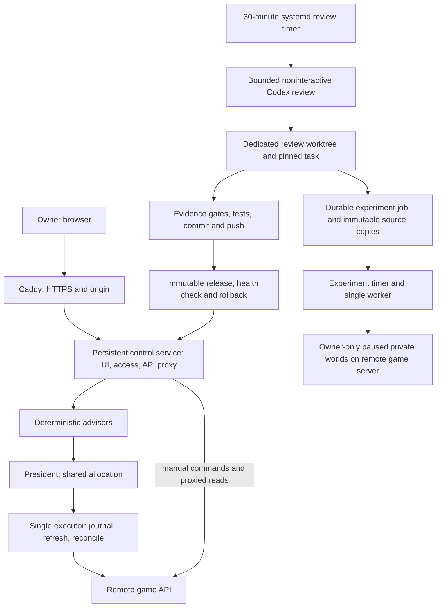

# Architecture and state boundaries

This repository contains a personal client. The central engine, world clock, accounts and other
players live on the remote server and are outside this repository. Start with [setup](setup.md),
[control-center policy](control-center.md), and [review operation](reviews.md).

Manual commands use the authenticated local proxy and the remote game API. They do not pass
through the President. They consume the same remote resources/queues, so the executor must refresh
and reconcile rather than assume it owns all activity. Browser requests never bypass site access.

## Continuous gameplay

`scripts/serve.mjs` starts the one Controller with a durable FileControlStorage and obtains the
kernel lease at loopback port 8790. Economic/Military Advisor proposals go through the President.
The Controller refreshes live state/options, accounts for independent construction/training/command
lanes, journals stable IDs before writes, and reconciles unknown/accepted outcomes. Browser tabs
render state; they do not own gameplay loops. A server restart reloads existing queues and IDs.
The current cadence is one second. Missing Codex access does not stop this path.

The lease is host-local. Running the starter bot or a second machine with this player's key can
still compete; coordination with external/manual actions is a limitation to evaluate, not a distributed
lock guarantee. The server remains the final validator of resources, limits and prerequisites.

## Strategic review and experimental learning

`scripts/review.py` owns the review lock, actual usage/auth checks, current evidence collection,
15-minute Codex budget, protected-file gates, structured report, checks, publishing and deployment.
Its prompt and report schema are versioned files, not hidden text in a timer or tmux session.
`progress.py` distinguishes research, experiments and deployed gameplay delivery. Stable work IDs
prevent silent task reshuffling; a verified negative comparison can complete a research question.

A long experiment snapshots baseline Git source and candidate source into a private job directory.
`scripts/experiment-policy.mts` runs each policy through the real Controller with a sandbox-only
transport. The server clock is paused between bounded steps; action follow-ups use one game tick,
queue/funding events wake decisions, and idle steps are capped at 30 ticks. Ten-minute snapshots
count completed buildings and trained units. Wall-clock duration is independent of simulated time.
Normal action validation, ownership, stable retry IDs and rate limits still apply.

The persistent worker runs outside Codex's time/quota budget. It shares the review lock to avoid
sandbox contention. The first worker supports a peaceful fresh-village comparison, one seed at a
time. It does not measure survival, require an LLM, grant free assets, or simulate another player's
account. Threat experiments need an appropriately controlled private scenario. Interrupted cases
retain evidence and restart from zero after owned-world cleanup; completed cases are retained.

Policy activation requires matched evidence for the actual candidate fingerprint and current rules
version, plus checks. Then the wrapper commits/pushes, atomically switches the release, restarts the
single executor and checks connection/execution preference. Push failures retain commits; failed
health restores the prior release. Source HEAD and the active release can therefore differ.

## Durable runtime state (private, not Git)

| Location | Purpose and recovery |
|---|---|
| `/var/lib/norm-steward-bot/control.json` | Connection key/settings, execution preference, pending/active action journal, decisions, production and cohort memory. Preserve across deployments. |
| Same directory: `access-token.txt`, `access-token.sha256` | Separate site credential and digest. Initialize once; rotate explicitly. |
| `/root/key.txt` | First-install player-key source used by the unit; saved Settings take precedence later. |
| `/var/lib/norm-steward-review/state.json` | Review status, usage observation/backoff, latest report and deployment metadata. |
| `.../work.json`, `.../backlog.json` | Active work contract and priorities; seeded from the committed example only on a fresh install. |
| `.../paused`, `.../installed.json` | Separate review pause and installation marker. |
| `.../worktree/` | Dedicated Git branch with durable unfinished prototypes. Never reset it to discard progress. |
| `.../runs/<UTC>/` | Redacted agent logs, evidence, sandbox ownership receipts, checks and reports. |
| `.../experiments/jobs/<id>/` | Job manifest, immutable baseline/candidate sources, traces, checkpoint tables and comparison. |
| `.../review.lock`, `.../experiment.lock` | Kernel flocks; stale files alone do not mean a lock is held. |
| `/var/lib/norm-steward-deploy/current` | Symlink to active immutable release. |
| `.../deployment.json`, `.../releases/<commit>/` | Actual release, prior release and rollback record. Runtime settings are shared, source is immutable. |
| Codex home and `/root/.ssh/` | Existing CLI authentication and Git transport credentials; provision separately, never export to Git. |

Logs and sandbox results can contain private strategy and account/world identifiers even after
credentials are redacted. The repository keeps reproducible harnesses, policy descriptions and
summarized findings, not production dumps. Read setup/health state locally when auditing deployment;
a GitHub-only reviewer should explicitly mark runtime facts it cannot verify.
