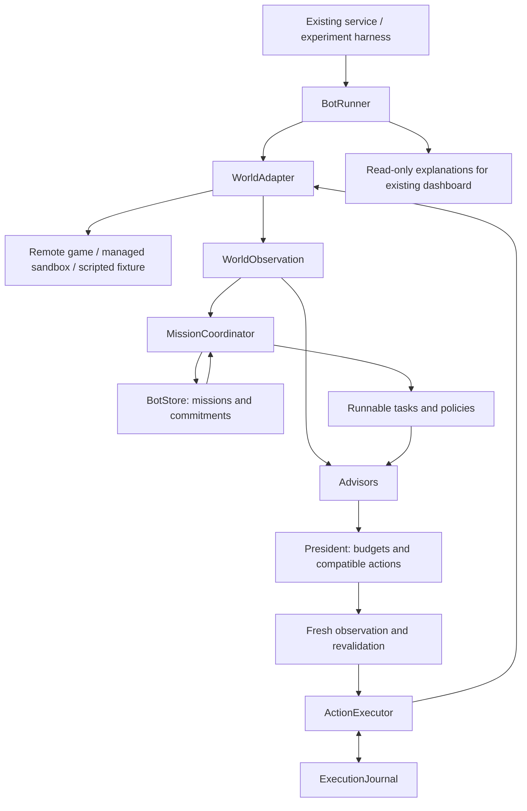
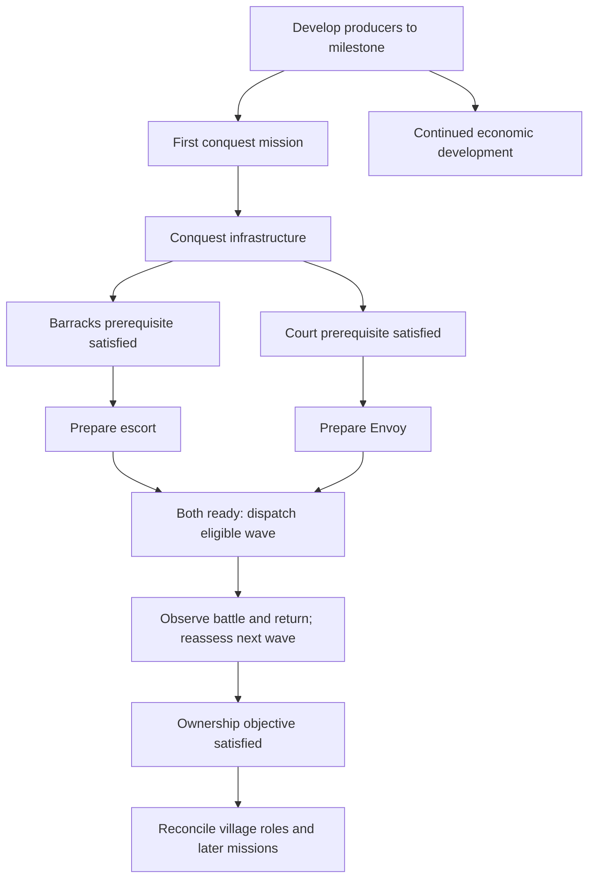

# Bot refactor: missions, world adapters, and durable execution

Status: proposed implementation design. Prepared 2026-11-17.

This document is a handoff for an implementing agent. It describes an architectural refactor,
not authorization to change strategy thresholds, enable gameplay, start experiments, or deploy.
Read `AGENTS.md`, [current policy](control-center.md), [strategy](strategy.md),
[architecture](architecture.md), and [review/deployment requirements](reviews.md) first.

## 1. Outcome and boundaries

Build one deterministic bot core that can run against a live Blitz world, an owner-created private
sandbox, or a scripted test adapter. The same mission, advisor, allocation, and execution logic must
run in each environment. Only transport, available observations, and clock control differ.

Replace implicit strategic coordination with explicit, persisted missions. A mission can contain
parallel tasks, prerequisites, completion conditions, and budget commitments. Actions remain short-lived
recommendations derived from current game facts. A durable journal separately tracks submitted requests.

The first delivery preserves current gameplay behavior. Subsequent policy changes—parallel missions,
multiple submissions per cycle, satellite roles and resource transfers—must be independently enabled
and validated. Describing them here does not silently activate them.

Retain the authoritative remote game, one President allocator, one gameplay executor, normal API
limits, dashboard/manual controls, persisted operator pause, server visibility boundaries, managed
sandbox broker, and release health/rollback process. Add no local game engine or authoritative clock.
No LLM participates in the gameplay decision loop. Do not introduce a separate worker/timer per mission.

## 2. Current implementation and the reason to change it

| Existing source | Current responsibility | Refactor direction |
|---|---|---|
| `scripts/serve.mjs` | UI, authentication, proxy and Controller startup | Remain the composition root; wire the runner into existing HTTP controls |
| `src/control/controller.ts` | Observation, strategy, reconciliation, persistence, timing and execution | Extract responsibilities behind small interfaces; retain compatibility during migration |
| `src/advisors/types.ts` | Shared proposal and advisor contracts | Preserve a common action-candidate contract; remove strategic dependence on whole old proposals |
| `src/advisors/economic.ts`, `military.ts` and helpers | Candidate generation and policy checks | Reuse calculations and checks as evaluators under explicit mission/policy constraints |
| `src/advisors/president.ts` | Ranked selection and village-level saving | Sole allocator; eventually select compatible actions across active missions |
| `src/advisors/conquest.ts` | Persistent conquest type plus policy/proposal replacement | Explicit mission policy and task dependencies |
| `src/control/storage.ts`, `types.ts` | Settings, execution journal and strategic memory in `control.json` | Versioned durable state with clear internal boundaries |
| `src/review/sandbox-client.ts`, `scripts/experiment-policy.mts` | Managed sandbox access and Controller experiments | Sandbox adapter using the same core, retaining broker ownership/credential safeguards |

Today `activeProposals` is supplied to evaluators primarily to remember a partially submitted
Pikeman/Shieldman cohort and protect its complement during conquest. Conquest also filters away
ordinary origin-village proposals. These are real coordination requirements, but their representation
mixes recommendation history, execution state and strategy.

Existing buildings need no corresponding proposal. A manually built Court satisfies a prerequisite
because it exists. Reconciliation of a request is a separate question from satisfying a mission.

## 3. Architecture



The runner coordinates components. The adapter performs world I/O. The mission coordinator owns
intent and lifecycle. Advisors generate actions. The President owns resource allocation. The executor
owns side effects, retry identities and reconciliation. None of the mission/advisor code opens network
connections, reads credentials, writes storage, sleeps, or starts timers.

Use modules/functions where appropriate; class names below describe responsibilities rather than
mandating an object-oriented framework. Avoid adding a graph/planning library until a concrete need
exceeds a small typed task model. Automatic action-space search (GOAP) is outside this refactor.

## 4. State boundaries

| State category | Authority / lifetime | Examples |
|---|---|---|
| Observed facts | Remote game; refreshed, potentially stale | Buildings, resources, owned/away/queued troops, transports, commands, ownership, cooldowns |
| Derived facts | Recomputed from observations | Production budgets, unmet prerequisites, milestones, runnable tasks |
| Strategic memory | Persisted local intent | Active conquest target, village roles, unfinished cohort commitment, interruption reason |
| Execution journal | Persisted before writes | Request ID, payload, scope, accepted queue/command ID, uncertain outcome |
| Historical evidence | Persisted with provenance as needed | A confirmed report, milestone achievement, stop/capture history |

Persisting a last observation for diagnostics is optional; never treat it as current after restart.
Resources in transit are observed future arrivals, not spendable inventory. Queued troops/buildings
are not available assets until completion, except the existing narrowly scoped build-successor forecast.

A `WorldScope` contains normalized server identity, account, world ID and epoch/round. Missions,
commitments and operations must carry that scope. A role also identifies a currently owned village.
Invalidate incompatible scope on rollover/account changes; preserve history without replaying old work.
Rules-version changes invalidate derived assessments and require fresh planning and experiment evidence.

Missing/unavailable data is unknown, not zero, false, a loss, or proof that an operation completed.

## 5. Suggested folder structure

```text
src/bot/
  model/                 # observations, scopes, mission/task/commitment/candidate types
  runner/                # lifecycle, one cycle coordinator, scheduling
  adapters/              # live API, managed sandbox, scripted test worlds
  observation/           # assemble and validate snapshots, derived world facts
  strategy/
    milestones.ts        # named live predicates and separate achievement definitions
    roles.ts             # village roles and capability requirements
    missions/            # economy, conquest; later logistics/development missions
    policies/            # recurring capacity, protection, funding, interruption rules
  advisors/              # candidate generation (may initially wrap src/advisors)
  allocation/            # President, resource ledger, queue/conflict constraints
  execution/             # journal, submit, retry, reconcile
  persistence/           # schema, atomic store and legacy migration
  diagnostics/           # serializable explanations and compatibility views
```

Tests and scripted observations live under `test/`; private captures, journals and experiment output
remain outside Git. Migrate incrementally rather than moving every file before behavior is covered.

## 6. Runner, adapter and observation contracts

Illustrative contracts: adapt names to the existing public API types without weakening their checks.

```ts
interface WorldAdapter {
  capabilities(): WorldCapabilities;
  observe(request: ObservationRequest): Promise<WorldObservation>;
  submit(request: JournalledRequest): Promise<ActionOutcome>;
  wait(request: WakeRequest, signal: AbortSignal): Promise<void>;
}

interface WorldCapabilities {
  clock: 'realtime' | 'lockstep' | 'paused-step' | 'scripted';
  canControlClock: boolean;
  // Expose further supported operations explicitly; never infer permission from a URL.
}

interface BotRunner {
  start(): Promise<void>;
  cycle(): Promise<CycleResult>;
  stop(): Promise<void>;
}
```

`WorldObservation` includes state/rules and individually stamped supplementary data (map, reports,
activity, etc.), plus scope, observed tick, observation time, rules version, and completeness/freshness
metadata. Multiple API reads are not an atomic snapshot: validate matching scope/epoch/rules and the
required tick relationships. A dispatch requiring fresh intelligence must not quietly use an older map
or assessment. Request authoritative battle simulation through the observation/I/O boundary.

Do not eagerly fetch every report or map every second. Mission requirements request relevant data,
with bounded caching and explicit invalidation. Credentials remain behind the adapter/broker boundary.

A live adapter waits for events or bounded polling and never steps the world. A sandbox adapter
controls only its registered owner-created world through the existing broker. It may advance a
lockstep/paused clock between decisions, with bounded steps and ambiguity checks. The existing
experiment harness may continue to own stepping initially; do not introduce two clock drivers.
A scripted adapter returns predetermined observations/outcomes and never contacts a live server.

The runner uses game ticks for gameplay deadlines and wall time for polling, network timeouts,
backoff and the existing under-ten-real-seconds build-successor condition. Same core does not mean
identical scheduling or clock permissions. Waiting and shutdown must be abortable; stop scheduling
new writes before releasing the existing executor lease.

## 7. Mission graph and lifecycle

Distinguish four concepts:

- **Milestone:** a named predicate over observed facts, e.g. `producerMinimum >= 15` or `villageCount >= 2`.
- **Mission:** persisted commitment to an outcome, e.g. capture a specific neutral village.
- **Task:** scoped work contributing to the mission, e.g. train the escort or develop the Court path.
- **Policy:** recurring constraints/choices, e.g. population runway or production-investment payback.

Use hierarchical grouping for ownership/explanation and a dependency DAG for readiness. Reject cycles,
missing references and incompatible scopes. A visual tree may show several edges into one task.
Parallel-ready tasks still compete for budget and queues; dependencies do not grant resources.



This diagram is a target capability, not permission to alter today's phase gates. Numeric thresholds
and exact prerequisite chains come from the current policy and live rules during the parity phase.
In particular, examples discussed conversationally about Cellar milestones do not override current policy.

Suggested lifecycle vocabulary:

```ts
type MissionStatus = 'active' | 'paused' | 'completed' | 'failed' | 'cancelled';
type TaskState = 'ready' | 'waiting' | 'running' | 'satisfied' | 'invalid';

interface MissionInstance {
  id: string;
  definition: string;
  definitionVersion: number;
  scope: WorldScope;
  villageId?: string;
  targetId?: string;
  status: MissionStatus;
  phase?: string;
  startedTick: number;
  memory: MissionMemory; // Discriminated, typed union; not arbitrary unvalidated JSON.
}
```

`phase` is a validated summary, not proof that prerequisites still hold. Persist target choice,
commitment, provenance-dependent campaign history and policy version. Derive fulfilled building
requirements from fresh facts. Do not persist a stale list of future purchases as unquestionable truth.

A failed prerequisite can become unsatisfied again after losses. Evaluate dependencies each cycle.
A waiting task retains intent and exposes a structured blocker plus wake condition; it does not
implicitly fail, relinquish every reservation, or trigger a new unrelated mission.

Mission policies return state updates, task views and constraints; the coordinator persists them.
They cannot submit actions. Define explicit success, failure, invalidation and interruption rules.
Preserve existing incoming-attack behavior during parity: do not introduce an automatic defensive
interrupt that reverses the owner's offensive policy. Plan-level pause, gameplay pause, review pause,
and quota backoff are distinct concepts.

### Milestones versus achievements

`ownsAtLeastTwoVillages` is a current fact and can become false. `firstConquestAchieved` is history
with supporting evidence. A target-specific capture mission succeeds from actual target ownership;
a broader account-expansion mission can succeed from village count. Do not label an unknown or manual
acquisition as a bot-attributed conquest. Specify whether loss after completion opens a recovery mission;
never silently resurrect a completed mission or repeat an irreversible step because a count changed.

## 8. Advisors, commitments and the President

Replace `activeProposals` with explicit inputs:

```ts
interface DecisionContext {
  world: WorldObservation;
  missions: readonly MissionView[];
  tasks: readonly TaskView[];
  roles: readonly VillageRole[];
  commitments: readonly StrategicCommitment[];
  execution: ExecutionView; // Pending requests and known occupied lanes, not strategic rationale.
}
```

A `StrategicCommitment` represents an unfinished obligation such as the remaining Shieldmen in a
journal-linked 3Pi1Sh cohort. Give it identity, scope, target counts, relevant baseline/provenance,
completion/invalidation rules and owning mission/task. Preserve current loss handling: remembered
cohorts must not turn troop losses into unlimited replacement purchases. A completed Pikeman request
may disappear from the journal without losing the distinct Shieldman obligation.

Candidates include mission/task provenance, action, costs, population, queue/lane requirements,
importance, blockers, validity/freshness requirements and explanation. They are recomputable and
may be discarded every cycle. A journal may retain an immutable candidate summary for audit, but
future strategy must not require the old proposal object or its reason text.

The President is the only allocator. It receives all eligible candidates and explicit constraints:
mission priority, exclusive/shared budget rights, protected resources/troops, accepted obligations,
queue occupancy and server action/cooldown limits. Policies do not secretly remove rival candidates;
excluded work stays explainable with a blocking constraint.

A reservation is a local scheduling commitment, not money the game server has locked. Define scope,
resource amounts or funding goal, priority, owner and release conditions. Unknown writes continue
encumbering their possible costs until reconciled. Avoid subtracting accepted costs twice: live stock
already reflects payment. Accepted queues still reserve their execution lane.

### Productive waiting and opportunity cost

An active conquest may wait for timber. Other tasks may use independent resources/lanes when they
do not violate its commitments. Building a Lumberyard is justified only by an explicit bounded
comparison showing that paying for it improves the objective's forecast, or by an independently
approved policy. A shortage alone does not justify spending the money being saved. Reuse existing
funding/payback calculations first; display assumptions and keep speculative income unspendable.
Define deterministic tie-breaking and a minimum benefit/commitment rule to avoid oscillation.

### Multiple actions per cycle

Initially keep the current one-action-per-cycle behavior. Later let the President return an ordered,
bounded compatible set. Different queues alone do not imply independence: account cooldowns, command
lanes, village resources, population, troops, standing orders and transports can be shared constraints.

Prefer sequential submission with updated state/budget after each result. Revalidate remaining
candidates; abandon/recompute the remainder when the world changes or an outcome is uncertain.
For any supported batch, check each result independently; HTTP success is not batch atomicity.
Persist stable IDs before each possible write. Never retry an entire partial-success batch with new IDs.
Current global combat-lane and server interval behavior remain until a separate change proves safe.

## 9. Cross-village roles and logistics

Represent role assignment explicitly: e.g. military origin, economic satellite, or balanced village.
Roles generate permitted missions and capability needs; do not hardcode that every new village must
repeat the first village's buildings. Preserve current behavior initially, then introduce role policies.

A satellite may need economic development and capacity/protection while the origin supplies troops.
Resource logistics is account-level coordination, not two villages independently sending everything:

- Donor spending reserves and garrison needs remain satisfied.
- Observe merchant/transport limits, travel time and destination storage headroom.
- In-transit resources cannot fund a purchase before arrival; avoid counting expected deliveries twice.
- A transfer has source/destination scope, request identity and arrival reconciliation.
- Lost villages, cancelled deliveries and changed demand invalidate or replan dependent work.

The current advisor/executor action subset is build/train/send. Resource transfers require explicitly
extending the candidate, transport, journal and reconciliation contracts using the existing public API;
implement them as a later feature, not as an implicit side effect of this refactor.

## 10. Execution, restart and reconciliation

Keep one executor and the existing host-local lease. It accepts only President-authorized actions.
Separate two questions: is the mission outcome true, and did this particular request execute?
Target ownership can establish success without proving which request caused it.

On each cycle:

1. Load/validate scope and obtain fresh observations.
2. Reconcile uncertain and accepted operations against queue IDs, commands, reports and state.
3. Reconcile mission lifecycle, dependencies, roles and strategic commitments.
4. Generate/evaluate candidates and allocate available resources.
5. Persist strategic updates; if gameplay is paused, publish explanations and stop before writing.
6. Refresh required facts and rerun selection immediately before any action.
7. Persist action identity, scope, payload, retry validity and obligations before submission.
8. Submit; interpret per-action results; persist accepted/rejected/uncertain outcomes.
9. Schedule a bounded wake from relevant events/deadlines and adapter capabilities.

On restart, load memory/journal and the exact saved execution preference, acquire the lease, then
observe/reconcile before any submission. Pending writes must not be lost by a new mission selection.
Different account/epoch/village ownership invalidates replay. Keep the same retry ID inside its valid
window; after expiry, unresolved outcomes follow the current pause-and-inspect behavior.
If a state change satisfies a requirement without attribution, do not duplicate the action or invent a
successful history. Missing matching reports do not establish victory. Preserve current conservative
conquest stop and cohort invalidation rules until separately tested.

## 11. Persistence and migration

Use a schema-versioned store. Logical boundaries need not mean multiple files: retain a single atomic
`control.json` aggregate initially so journal and commitment updates cannot tear across separate writes.
Continue mode-0600 files, mode-0700 directories, atomic replacement and fsync behavior.

Migrate legacy `pending`, `active`, `defenseComplements`, `conquest`, `scouting`, `raids` and production
memory without losing request IDs, outcomes, campaign waves, report provenance, scopes or the saved
`automatic` flag. Retain private connection settings and access-token behavior.

Migration must be deterministic, validated and repeatable without duplicate missions. Fail closed on
corrupt or unsupported schemas; never silently replace unreadable state with an empty bot. Preserve a
private pre-migration backup and define rollback compatibility before production activation: an old
release must not be restarted against an unreadable new store. Use a backward-compatible transition
schema or a tested compatibility reader; restoring an old journal after new writes is unsafe.

## 12. Testing and evidence

| Layer | Required evidence |
|---|---|
| Pure decision fixtures | State + strategic memory + execution facts produce expected eligible actions, blockers and mission updates |
| Sequential scenarios | Manual actions, changed queues, partial cohorts, attacks, losses and transfers alter the next decision correctly |
| Restart/crash scenarios | Before write, after possible server acceptance, after acceptance persistence and after completion; stable IDs and pauses survive |
| Adapter contract tests | Same core semantics for live-shaped, sandbox and scripted observations; capability/clock boundaries enforced |
| Managed sandbox comparisons | Behavior parity first; later matched candidate/baseline outcomes for policy changes |

Use small synthetic/redacted fixtures with explicit tick/rules/scope. Test invariants and outcomes,
not serialized copies of every incidental proposal field. Inject a clock, deterministic IDs and fake
transport for repeatable tests. Snapshots cannot prove long-term strategy value or server acceptance;
use the existing managed sandbox experiment workflow for that.

Minimum regression scenarios:

- Manually built prerequisites advance a mission without matching proposal history.
- Escort training and Court construction can be represented as parallel tasks; dispatch waits for both.
- A blocked conquest retains intent; spending elsewhere obeys its reservations.
- Insufficient resources do not automatically authorize a producer upgrade.
- Completed Pikemen with missing Shieldmen survive restart as a commitment, not a completed-request dependency.
- Troops away/queued are counted correctly; losses do not trigger unintended cohort replacement.
- Target captured manually satisfies ownership without invented attack attribution.
- Origin lost, target ownership changed, epoch changed and stale rules invalidate the appropriate work.
- Unknown writes suppress duplicate spending; expired retry windows preserve the current pause behavior.
- Paused gameplay observes/reconciles but submits no gameplay actions; restart never resumes it implicitly.
- A second build is allowed only in the current strict successor window; no speculative training unlock.
- Compatible-action selection respects aggregate budgets, partial failures and global cooldowns.
- Scripted/sandbox modes cannot issue live-world writes or advance a live clock.

Run `npm run typecheck`, `npm test`, and `npm run build:web`; see [setup](setup.md) for the Mac Python
and temporary-directory test requirements. Visually inspect any dashboard changes. Sandbox evidence
must match the actual candidate fingerprint and current rules under the existing review gates.

## 13. Delivery sequence

1. **Characterize behavior.** Map existing checks and add the missing scenario tests around conquest,
   cohort obligations, uncertain writes and manual intervention. Record explicit policy invariants.
2. **Extract runner/adapter boundaries.** Keep Controller/HTTP views compatible and single-action cadence.
   Route existing experiments through the same core without changing broker/clock ownership.
3. **Separate journal and strategic commitments.** Remove evaluator dependency on whole active proposals;
   migrate partial cohorts without changing priority, affordability or loss behavior.
4. **Extract conquest as a mission.** Persist lifecycle and provenance, derive tasks from live state,
   preserve current proposal selection, building successor and attack behavior. Establish sandbox parity.
5. **Represent economy policies and task graph.** Centralize milestones and constraints; preserve current
   numeric gates. Explain blocked/runnable tasks through existing dashboard diagnostics.
6. **Add features separately.** Parallel economy/conquest budgets, multi-action cycles, village roles,
   and logistics each require their own tests, policy decision and matched experiment evidence.

Each stage should leave one runnable executor and a reviewable diff. Do not combine the refactor with
new balance assumptions, broad strategy tuning, a UI rewrite, a new dependency stack, or changes to
scheduled review work contracts. Preserve dirty/unpushed remote review work; never reset it for convenience.

## 14. Handoff acceptance criteria

The architectural refactor is complete when:

- One runner can use a live, managed-sandbox or scripted adapter without branching strategy by environment.
- Current conquest is an explicit persisted mission; tasks reflect actual state and survive restart.
- Advisors consume observed facts, constraints and typed commitments rather than previous proposal objects.
- President remains the only allocator; executor remains the only gameplay writer.
- The first delivery preserves current policy, manual interaction, journal guarantees and pause settings.
- All legacy private state has a tested migration and safe release rollback story.
- Decisions expose mission/task identity, prerequisites, blockers, reservations and next wake reason.
- Tests and matched sandbox evidence support claimed parity; later features are clearly identified and gated.

The initial diagnostic view should make the future planning website possible: milestone predicates,
mission hierarchy, dependency edges, task status, village roles, resource reservations, observed queues,
and linked execution outcomes. No new website is required by this handoff. A future graph should label
illustrative policy separately from live state and must never create a browser-owned execution loop.

### Suggested implementation-agent instruction

> Implement the staged architectural refactor in `docs/bot-refactor-design.md`, beginning with behavior
> characterization and adapter/runner extraction. Preserve the current gameplay policy and single-action
> cadence. Do not enable the later strategy features implicitly. Inspect current code and private-state
> migration requirements before edits; preserve unrelated work. Follow AGENTS.md and existing experiment,
> pause, deployment and credential boundaries. Report completed stages, test evidence, migration/rollback
> compatibility and remaining work. Do not deploy as part of this design handoff.
