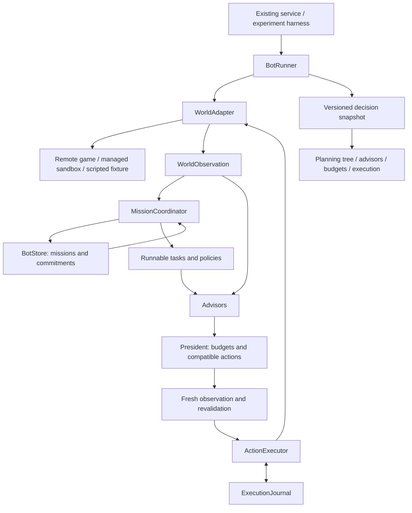
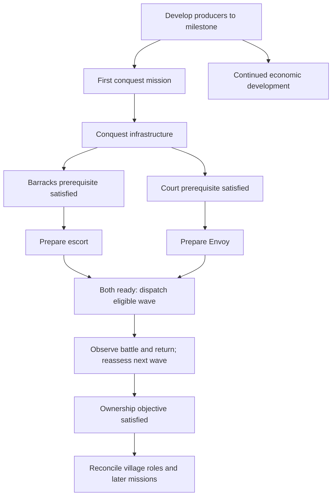

# Bot refactor: missions, world adapters, durable execution, and planning UI

Status: backend mission planning architecture, version-2 persistence/migration, execution journal,
and version-1 planning projection are implemented. Economic-city roles and resource requests fulfilled
by capital trade are implemented, with recurring conquest. Automated scouting and raid bot behavior was
removed. By owner decision, no gameplay parity harness was added. Parallel mission budgets, multiple
submissions per cycle, satellite roles, defender requests, and overflow fulfilment remain unavailable.
The design below retains the broader proposal and acceptance criteria for future work.

This document is a handoff for an implementing agent. It describes an architectural refactor,
not authorization to change strategy thresholds, enable gameplay, start experiments, or deploy.
Read `AGENTS.md`, [current policy](control-center.md), [strategy](strategy.md),
[architecture](architecture.md), and [review/deployment requirements](reviews.md) first.

## 1. Outcome and boundaries

Build one deterministic bot core that can run against a live Blitz world, an owner-created private
sandbox, or a scripted test adapter. The same mission, advisor, allocation, and execution logic must
run in each environment. Only transport, available observations, and clock control differ.

Replace implicit strategic coordination with explicit, persisted missions. A mission can contain
parallel tasks, prerequisites, completion conditions, and budget commitments. Actions remain short-lived
recommendations derived from current game facts. A durable journal separately tracks submitted requests.

Deliver the architectural refactor and the planning UI redesign as one coordinated implementation,
with internal verification checkpoints and one production cutover. The checkpoints below are a work
order, not a requirement to spread the work across runs or deploy intermediate architectures.
Preserve current gameplay behavior. Parallel budgets, multiple submissions per cycle, satellite role
policies and resource transfers have explicit acceptance criteria below; their supporting models and
UI belong in this delivery, but new gameplay behavior requires its own policy approval and evidence.
An unimplemented capability must be labelled unavailable, rather than presented as active work.

The planning UI is a required deliverable in the existing dashboard: an interactive mission/task tree
with dependency links, advisor views, allocation explanations and execution history. It must explain
what the bot is pursuing, what it is doing now, and why other work is waiting.

Retain the authoritative remote game, one President allocator, one gameplay executor, normal API
limits, dashboard/manual controls, persisted operator pause, server visibility boundaries, managed
sandbox broker, and release health/rollback process. Add no local game engine or authoritative clock.
No LLM participates in the gameplay decision loop. Do not introduce a separate worker/timer per mission.

## 2. Current implementation and the reason to change it

| Existing source | Current responsibility | Refactor direction |
|---|---|---|
| `scripts/serve.mjs` | UI, authentication, proxy and Controller startup | Remain the composition root; wire the runner into existing HTTP controls |
| `src/control/controller.ts` | Observation, strategy, reconciliation, persistence, timing and execution | Extract responsibilities behind small interfaces; retain compatibility during migration |
| `src/advisors/types.ts` | Shared proposal and advisor contracts | Preserve a common action-candidate contract; remove strategic dependence on whole old proposals |
| `src/advisors/economic.ts`, `military.ts` and helpers | Candidate generation and policy checks | Reuse calculations and checks as evaluators under explicit mission/policy constraints |
| `src/advisors/president.ts` | Ranked selection and village-level saving | Sole allocator; eventually select compatible actions across active missions |
| `src/advisors/conquest.ts` | Persistent conquest type plus policy/proposal replacement | Explicit mission policy and task dependencies |
| `src/control/storage.ts`, `types.ts` | Settings, execution journal and strategic memory in `control.json` | Versioned durable state with clear internal boundaries |
| `scripts/sandbox/client.ts`, `scripts/sandbox/runner.mts` | Managed sandbox access and Controller experiments | Sandbox adapter using the same core, retaining broker ownership/credential safeguards |

Today `activeProposals` is supplied to evaluators primarily to remember a partially submitted
Pikeman/Shieldman cohort and protect its complement during conquest. Conquest also filters away
ordinary origin-village proposals. These are real coordination requirements, but their representation
mixes recommendation history, execution state and strategy.

Existing buildings need no corresponding proposal. A manually built Court satisfies a prerequisite
because it exists. Reconciliation of a request is a separate question from satisfying a mission.

## 3. Architecture



The runner coordinates components. The adapter performs world I/O. The mission coordinator owns
intent and lifecycle. Advisors generate actions. The President owns resource allocation. The executor
owns side effects, retry identities and reconciliation. None of the mission/advisor code opens network
connections, reads credentials, writes storage, sleeps, or starts timers.

Use modules/functions where appropriate; class names below describe responsibilities rather than
mandating an object-oriented framework. Avoid adding a graph/planning library until a concrete need
exceeds a small typed task model. Automatic action-space search (GOAP) is outside this refactor.

## 4. State boundaries

| State category | Authority / lifetime | Examples |
|---|---|---|
| Observed facts | Remote game; refreshed, potentially stale | Buildings, resources, owned/away/queued troops, transports, commands, ownership, cooldowns |
| Derived facts | Recomputed from observations | Production budgets, unmet prerequisites, milestones, runnable tasks |
| Strategic memory | Persisted local intent | Active conquest target, village roles, unfinished cohort commitment, interruption reason |
| Execution journal | Persisted before writes | Request ID, payload, scope, accepted queue/command ID, uncertain outcome |
| Historical evidence | Persisted with provenance as needed | A confirmed report, milestone achievement, stop/capture history |

Persisting a last observation for diagnostics is optional; never treat it as current after restart.
Resources in transit are observed future arrivals, not spendable inventory. Queued troops/buildings
are not available assets until completion, except the existing narrowly scoped build-successor forecast.

A `WorldScope` contains normalized server identity, account, world ID and epoch/round. Missions,
commitments and operations must carry that scope. A role also identifies a currently owned village.
Invalidate incompatible scope on rollover/account changes; preserve history without replaying old work.
Rules-version changes invalidate derived assessments and require fresh planning and experiment evidence.

Missing/unavailable data is unknown, not zero, false, a loss, or proof that an operation completed.

Version the store envelope, strategic format, execution-journal format and diagnostic API separately
from the code release and game rules. A new code commit alone does not invalidate persisted state.
On every startup reconcile against the existing remote world; a recoverable strategic-format mismatch
can rebuild planning state. Execution identities, unresolved outcomes, paid cohort provenance, saved
execution preference and historical evidence cannot be discarded as a cache. Section 11 defines the
recovery and deployment contract.

## 5. Suggested folder structure

```text
src/bot/
  model/                 # observations, scopes, mission/task/commitment/candidate types
  runner/                # lifecycle, one cycle coordinator, scheduling
  adapters/              # live API, managed sandbox, scripted test worlds
  observation/           # assemble and validate snapshots, derived world facts
  strategy/
    milestones.ts        # named live predicates and separate achievement definitions
    roles.ts             # village roles and capability requirements
    missions/            # economy, conquest; later logistics/development missions
    policies/            # recurring capacity, protection, funding, interruption rules
  advisors/              # candidate generation (may initially wrap src/advisors)
  allocation/            # President, resource ledger, queue/conflict constraints
  execution/             # journal, submit, retry, reconcile
  persistence/           # schema, atomic store and legacy migration
  diagnostics/           # serializable explanations and compatibility views
```

Tests and scripted observations live under `test/`; private captures, journals and experiment output
remain outside Git. Characterize behavior before moving files, within the same implementation run.

Before moving runtime logic, update `scripts/sandbox/broker.py`'s fingerprint and
`scripts/review/progress.py`'s runtime/policy classifiers to include nested `src/bot/` modules and all
decision-affecting helpers, including retained helpers under `src/review/`. Today the fingerprint only
hashes top-level `src/advisors/*.ts` and `src/control/*.ts`. Include a fingerprint-format version;
receipts from the old format cannot validate new code. Verify that a nested policy change invalidates
evidence and receives the correct deployment classification. Preserve the existing evidence and work
contracts while maintaining these path mappings as part of this owner-driven refactor.

## 6. Runner, adapter and observation contracts

Illustrative contracts: adapt names to the existing public API types without weakening their checks.

```ts
interface WorldAdapter {
  capabilities(): WorldCapabilities;
  observe(request: ObservationRequest, signal: AbortSignal): Promise<WorldObservation>;
  recoverMembership(request: MembershipRequest, signal: AbortSignal): Promise<MembershipOutcome>;
  submit(request: JournalledRequest, signal: AbortSignal): Promise<ActionOutcome>;
  wait(request: WakeRequest, signal: AbortSignal): Promise<void>;
}

interface WorldCapabilities {
  clock: 'realtime' | 'lockstep' | 'paused-step' | 'scripted';
  canControlClock: boolean;
  // Expose further supported operations explicitly; never infer permission from a URL.
}

interface BotRunner {
  start(): Promise<void>;
  cycle(): Promise<CycleResult>;
  stop(): Promise<void>;
}
```

`WorldObservation` includes state/rules and individually stamped supplementary data (map, reports,
activity, etc.), plus scope, observed tick, observation time, rules version, and completeness/freshness
metadata. Multiple API reads are not an atomic snapshot: validate matching scope/epoch/rules and the
required tick relationships. A dispatch requiring fresh intelligence must not quietly use an older map
or assessment. Request authoritative battle simulation through the observation/I/O boundary.

Do not eagerly fetch every report or map every second. Mission requirements request relevant data,
with bounded caching and explicit invalidation. Credentials remain behind the adapter/broker boundary.

The observation loop has two bounded passes: obtain base state/rules, then let pure mission/advisor
functions return typed `ObservationNeed` values for map regions, report details or battle assessments.
The runner deduplicates and obtains those needs through the adapter, merges validated results, and
evaluates decisions. Use at most one supplementary acquisition pass per cycle and one during final
revalidation, with an explicit finite query-count and wall-time budget matching existing bounded
searches. If inputs change or the budget is exhausted, defer affected candidates with a structured
unknown/stale-data blocker and bounded wake; do not recurse into unbounded observation/planning.
Assessment cache keys contain normalized simulation inputs, scope and rules version; candidates also
declare required observation freshness. Matching ticks alone do not make different assessments reusable.

`observe()` never joins a world. The runner's membership recovery handles only `NOT_IN_WORLD` or
zero owned villages in the selected running world, preserving current autojoin/refounding behavior.
The single executor gates and records that explicit operation, delegates to `recoverMembership()`,
then rereads state/rules before ordinary planning. Membership recovery uses the upstream idempotent
join contract, not a fabricated build/train/send client ID; it respects pause, revision, shutdown and
429 backoff. Other read errors never authorize a join. Manual proxy writes remain external activity.

A live adapter waits for events or bounded polling and never steps the world. A sandbox adapter
controls only its registered owner-created world through the existing broker. It may advance a
lockstep/paused clock between decisions, with bounded steps and ambiguity checks. The existing
experiment harness may continue to own stepping initially; do not introduce two clock drivers.
A scripted adapter returns predetermined observations/outcomes and never contacts a live server.

The runner uses game ticks for gameplay deadlines and wall time for polling, network timeouts,
backoff and the existing under-ten-real-seconds build-successor condition. Same core does not mean
identical scheduling or clock permissions. Waiting and shutdown must be abortable; stop scheduling
new writes before releasing the existing executor lease.

Aborting an in-flight submission does not prove rejection: retain its journal entry as uncertain.
Use typed outcomes for accepted, explicitly rejected and uncertain actions; represent rate-limit
deadlines and authentication failures separately. Honor Retry-After, preserve retry identities, and
pause on authentication failure as today. `start()` and `cycle()` cannot create overlapping cycles;
`stop()` awaits the active cycle and its durable bookkeeping before the host releases the lease.
Keep sandbox clock suspension separate from a game world's domain status so live paused worlds
cannot be made runnable by the sandbox adapter's clock normalization.

## 7. Mission graph and lifecycle

Distinguish four concepts:

- **Milestone:** a named predicate over observed facts, e.g. `producerMinimum >= 15` or `villageCount >= 2`.
- **Mission:** persisted commitment to an outcome, e.g. capture a specific neutral village.
- **Task:** scoped work contributing to the mission, e.g. train the escort or develop the Court path.
- **Policy:** recurring constraints/choices, e.g. population runway or production-investment payback.

Use hierarchical grouping for ownership/explanation and a dependency DAG for readiness. Reject cycles,
missing references and incompatible scopes. A visual tree may show several edges into one task.
Parallel-ready tasks still compete for budget and queues; dependencies do not grant resources.

Use separate typed edges: `contains` for an acyclic single-parent ownership tree, `requires` for
readiness, and `contributesTo` for explanation of shared outcomes. Only `requires` edges gate readiness;
an active mission does not wait for its children before allowing those children to start. Shared
prerequisites have one canonical task ID and references from other branches. Dependency cycles and
contradictory ownership are invalid. The diagram below is illustrative; its grouping arrows are not
an executable dependency definition.



This diagram is a target capability, not permission to alter today's phase gates. Numeric thresholds
and exact prerequisite chains come from the current policy and live rules during the parity phase.
In particular, examples discussed conversationally about Cellar milestones do not override current policy.

Suggested lifecycle vocabulary:

```ts
type MissionStatus = 'active' | 'paused' | 'completed' | 'failed' | 'cancelled';
type TaskState = 'ready' | 'waiting' | 'running' | 'satisfied' | 'invalid';

interface MissionInstance {
  id: string;
  definition: string;
  definitionVersion: number;
  scope: WorldScope;
  villageId?: string;
  targetId?: string;
  status: MissionStatus;
  phase?: string;
  startedTick: number;
  memory: MissionMemory; // Discriminated, typed union; not arbitrary unvalidated JSON.
}
```

`phase` is a validated summary, not proof that prerequisites still hold. Persist target choice,
commitment, provenance-dependent campaign history and policy version. Derive fulfilled building
requirements from fresh facts. Do not persist a stale list of future purchases as unquestionable truth.

Mission creation is an idempotent upsert by scope, definition and its stable domain subject (origin or
account objective; target only when fixed at creation). Later target selection does not change the
creation key. Persist an incarnation ID; a definition-version change migrates that instance or
rebuilds its derived tasks instead of creating another active mission. Terminal instances remain
history. Current policy does not automatically reopen completed, failed or cancelled conquest; any
future recovery mission has a new incarnation and explicit creation rule.

Task IDs combine mission incarnation and a semantic task key. Task views carry title, owner, kind,
predicate/progress, typed edges, status, blockers and wake conditions. A satisfied current-state task
can become unsatisfied; an achievement retains its evidence. Recurring recruitment uses a recurring
policy/task with distinct cohort commitments; conquest wave ordinals identify distinct attempts.
Candidate deduplication uses scope, village, action payload and intended target/commitment, collecting
all contributing task IDs. One shared prerequisite produces one purchase. Each actual request still
gets its own stable journal identity. Start with typed conquest tasks and economy policy views;
do not build a generic executable workflow language for this delivery.

A failed prerequisite can become unsatisfied again after losses. Evaluate dependencies each cycle.
A waiting task retains intent and exposes a structured blocker plus wake condition; it does not
implicitly fail, relinquish every reservation, or trigger a new unrelated mission.

Mission policies return state updates, task views and constraints; the coordinator persists them.
They cannot submit actions. Define explicit success, failure, invalidation and interruption rules.
Preserve existing incoming-attack behavior during parity: do not introduce an automatic defensive
interrupt that reverses the owner's offensive policy. Plan-level pause, gameplay pause, review pause,
and quota backoff are distinct concepts.

Mission pause/cancellation prohibits new requests attributable to that mission and releases its
unspent funding reservations. Existing submitted/accepted work and linked obligations remain under
reconciliation; cancellation neither recalls armies nor cancels server queues. Retrying an uncertain
write is still a submission and respects the saved gameplay pause and retry validity.

### Milestones versus achievements

`ownsAtLeastTwoVillages` is a current fact and can become false. `firstConquestAchieved` is history
with supporting evidence. A target-specific capture mission succeeds from actual target ownership;
a broader account-expansion mission can succeed from village count. Do not label an unknown or manual
acquisition as a bot-attributed conquest. Specify whether loss after completion opens a recovery mission;
never silently resurrect a completed mission or repeat an irreversible step because a count changed.

## 8. Advisors, commitments and the President

Replace `activeProposals` with explicit inputs:

```ts
interface DecisionContext {
  world: WorldObservation;
  missions: readonly MissionView[];
  tasks: readonly TaskView[];
  roles: readonly VillageRole[];
  commitments: readonly StrategicCommitment[];
  execution: ExecutionView; // Pending requests and known occupied lanes, not strategic rationale.
}
```

A `StrategicCommitment` represents an unfinished obligation such as the remaining Shieldmen in a
journal-linked 3Pi1Sh cohort. Give it identity, scope, target counts, relevant baseline/provenance,
completion/invalidation rules and owning mission/task. Preserve current loss handling: remembered
cohorts must not turn troop losses into unlimited replacement purchases. A completed Pikeman request
may disappear from the journal without losing the distinct Shieldman obligation.

Candidates include mission/task provenance, action, costs, population, queue/lane requirements,
importance, blockers, validity/freshness requirements and explanation. They are recomputable and
may be discarded every cycle. A journal may retain an immutable candidate summary for audit, but
future strategy must not require the old proposal object or its reason text.

The President is the only allocator. It receives all eligible candidates and explicit constraints:
mission priority, exclusive/shared budget rights, protected resources/troops, accepted obligations,
queue occupancy and server action/cooldown limits. Policies do not secretly remove rival candidates;
excluded work stays explainable with a blocking constraint.

A reservation is a local scheduling commitment, not money the game server has locked. Define scope,
resource amounts or funding goal, priority, owner and release conditions. Unknown writes continue
encumbering their possible costs until reconciled. Avoid subtracting accepted costs twice: live stock
already reflects payment. Accepted queues still reserve their execution lane.

For this delivery preserve the existing comparator, per-village saving behavior and queue exceptions.
Apply constraints in order: scope/visibility/freshness and gameplay validity; unresolved-operation and
lane exclusions; paid cohort obligations and conquest spending exclusions; existing importance and
tie-breaking; existing per-village affordability/saving choice. Mission priority is explanatory until
an independently approved policy defines how it overrides that order. Do not allow newly visible
economy candidates to bypass today's conquest exclusivity.

Reservations are a discriminated union: a `fundingGoal` explains a target/shortfall without itself
locking stock; `exclusiveSpending` excludes specified rival spending under an explicit policy; an
`uncertainCost` conservatively encumbers a possible payment until reconciliation. Store owner IDs,
scope, resource vector/goal, precedence and release condition, plus linked operation where relevant.
Release non-execution reservations when their owner terminates, loses scope, or changes its funding
target; regenerate them from fresh planning. Never subtract the same cost from observed stock twice.
If constraints leave no eligible candidate, publish their reasons and wake conditions rather than
inventing work. Existing training income headroom remains a forecast distinct from stock reservations.

### Productive waiting and opportunity cost

An active conquest may wait for timber. Other tasks may use independent resources/lanes when they
do not violate its commitments. Building a Lumberyard is justified only by an explicit bounded
comparison showing that paying for it improves the objective's forecast, or by an independently
approved policy. A shortage alone does not justify spending the money being saved. Reuse existing
funding/payback calculations first; display assumptions and keep speculative income unspendable.
Define deterministic tie-breaking and a minimum benefit/commitment rule to avoid oscillation.

### Multiple actions per cycle

Initially keep the current one-action-per-cycle behavior. Later let the President return an ordered,
bounded compatible set. Different queues alone do not imply independence: account cooldowns, command
lanes, village resources, population, troops, standing orders and transports can be shared constraints.

Prefer sequential submission with updated state/budget after each result. Revalidate remaining
candidates; abandon/recompute the remainder when the world changes or an outcome is uncertain.
For any supported batch, check each result independently; HTTP success is not batch atomicity.
Persist stable IDs before each possible write. Never retry an entire partial-success batch with new IDs.
Current global combat-lane and server interval behavior remain until a separate change proves safe.

The UI may show several ready tasks while the active execution policy still allows one submission
per cycle. It must distinguish task parallelism, already accepted concurrent queues, and submission
cadence; a readiness badge is not a promise that all visible actions will execute together.

## 9. Cross-village roles and logistics

Represent role assignment explicitly: e.g. military origin, economic satellite, or balanced village.
Roles generate permitted missions and capability needs; do not hardcode that every new village must
repeat the first village's buildings. Preserve current behavior initially, then introduce role policies.

A satellite may need economic development and capacity/protection while the origin supplies troops.
Resource logistics is account-level coordination, not two villages independently sending everything:

- Donor spending reserves and garrison needs remain satisfied.
- Observe merchant/transport limits, travel time and destination storage headroom.
- In-transit resources cannot fund a purchase before arrival; avoid counting expected deliveries twice.
- A transfer has source/destination scope, request identity and arrival reconciliation.
- Lost villages, cancelled deliveries and changed demand invalidate or replan dependent work.

The current advisor/executor action subset is build/train/send. Resource transfers require explicitly
extending the candidate, transport, journal and reconciliation contracts using the existing public API;
implement them as a later feature, not as an implicit side effect of this refactor.

## 10. Execution, restart and reconciliation

Keep one executor and the existing host-local lease. It accepts only President-authorized actions.
Separate two questions: is the mission outcome true, and did this particular request execute?
Target ownership can establish success without proving which request caused it.

On each cycle:

1. Load/validate scope and obtain fresh observations.
2. Reconcile uncertain and accepted operations against queue IDs, commands, reports and state.
3. Reconcile mission lifecycle, dependencies, roles and strategic commitments.
4. Generate/evaluate candidates and allocate available resources.
5. Persist strategic updates; if gameplay is paused, publish explanations and stop before writing.
6. Refresh required facts and repeat execution/mission/commitment reconciliation, candidate generation
   and allocation against that refreshed observation immediately before any action.
7. Atomically persist resulting strategic updates, obligations and prepared action identity, scope,
   exact payload and retry validity before submission. Retrying preserves the original payload/ID.
8. Submit; interpret per-action results; persist accepted/rejected/uncertain outcomes.
9. Schedule a bounded wake from relevant events/deadlines and adapter capabilities.

On restart, load memory/journal and the exact saved execution preference, acquire the lease, then
observe/reconcile before any submission. Pending writes must not be lost by a new mission selection.
Different account/epoch/village ownership invalidates replay. Keep the same retry ID inside its valid
window; after expiry, unresolved outcomes follow the current pause-and-inspect behavior.
If a state change satisfies a requirement without attribution, do not duplicate the action or invent a
successful history. Missing matching reports do not establish victory. Preserve current conservative
conquest stop and cohort invalidation rules until separately tested.

The runner serializes state transitions and settings/pause commands through one mutation owner.
Capture a connection/execution revision for a cycle; recheck revision, scope, saved pause and stop
state after awaited revalidation/persistence and immediately before transport submission. A stale
selection cannot authorize a write. A pause arriving after submission prevents subsequent writes
while allowing the result and its obligations to be persisted and reconciled.

If the pre-submit save fails, issue no write. If acceptance/outcome persistence fails after a possible
write, halt new submissions and expose a persistence fault; recover from the previously durable exact
request during restart reconciliation. Do not clear it, generate a replacement ID or continue spending
from an in-memory-only accepted result. Mission cancellation and scope invalidation cannot erase the
audit of that possible effect, even when they permanently prohibit replay.

## 11. Persistence and migration

Use a schema-versioned store. Logical boundaries need not mean multiple files: retain a single atomic
`control.json` aggregate initially so journal and commitment updates cannot tear across separate writes.
Continue mode-0600 files, mode-0700 directories, atomic replacement and fsync behavior.

Migrate legacy `pending`, `active`, `defenseComplements`, `conquest`, `scouting`, `raids` and production
memory without losing request IDs, outcomes, campaign waves, report provenance, scopes or the saved
`automatic` flag. Retain private connection settings and access-token behavior.

Migration must be deterministic, validated and repeatable without duplicate missions. Preserve a
private pre-migration backup. Choose forward migration with startup reconciliation for this delivery;
backward compatibility with every historical release is not required.

The versioned envelope separates connection/execution preference, durable execution evidence and
strategic data. Validate each partition before use. An incompatible or missing planning partition can
be rebuilt from fresh state, known mission intent, preserved campaign evidence and journal-linked
commitments. Observed queues and manual work occupy lanes without invented bot attribution. Preserve
paid cohort baselines/counts and consumed-report provenance needed to prevent replacement spending.
If those cannot be recovered, show an explicit recovery blocker for affected work instead of inventing
the missing intent. Preserve terminal campaign evidence so rebuilding does not restart a stopped plan.

An ordinary code-version mismatch does nothing to the store. A known strategic-schema mismatch runs
a migration or rebuild and records its reason. An unreadable envelope, unsupported journal schema,
missing/corrupt execution evidence, or unknown execution preference blocks gameplay until reconciled
or inspected. Do not silently recreate credentials, resume a pause, discard uncertain operations, or
replace the whole file with an empty bot. Remote facts alone cannot reconstruct every possible write.

Deployment records the journal/store compatibility of the candidate and rollback target. Automatic
rollback may restart only a release proven able to read and preserve the current execution evidence;
parsing unknown fields is insufficient. When no such release exists, stop gameplay and report recovery
required for a corrected compatible release. Retain the owner's execution preference separately from
that temporary recovery inhibit. Never restore an old journal after new writes. This requires adapting
the current deployment helper, which otherwise unconditionally restarts the previous release on
health failure, while preserving connection, pause and health checks.

## 12. Required planning UI redesign

Redesign the existing personal control center in the same delivery as the core. Keep React, the current
service/authentication, dark ledger visual language, Map & commands, Town, Settings and existing manual
gameplay. This is a bot-planning workspace rather than a separate website or graph editor.

### Navigation and information hierarchy

The main navigation becomes **Bot**, **Map & commands**, **Settings**. Bot contains the following tabs;
Plan is the default, and selected tab/entity/filter is addressable in the URL without changing the
selected gameplay world. Advisor subviews are filters within Advisors rather than one top-level tab
per advisor. Review pause remains independent from gameplay status.

| Tab | Primary question | Required content |
|---|---|---|
| Plan | What are we pursuing, and what is blocking progress? | Mission/task tree, prerequisite links, milestones, blockers, selected-node inspector and next wake |
| Advisors | What does each advisor recommend? | President summary plus Economy, Military, Conquest and registered advisor filters; ranked candidates, rejected/waiting work and explanation |
| Budgets | Why can or cannot we spend? | Per-village stock, funding goals, exclusive reservations, uncertain costs, income headroom, queue/lane constraints and allocation decisions |
| Execution | What actually happened? | Prepared/submitted/uncertain/accepted/completed operations, linked tasks and queue/command/report evidence, manual-state attribution where known |
| Reviews | What strategy work is being evaluated? | Existing review status, experiments/evidence, work contract and separate review pause/resume controls |

A persistent summary shows selected account/world, village filter, world tick, last observation and
evaluation times, execution running/paused/recovery-required state, connection freshness and next
intended action/wake. Provide all-villages and single-owned-village views; account-level dependencies
stay visible as references when filtering. Do not place a new mission editor, gameplay enable switch,
budget slider or logistics dispatch control in this redesign. Preserve existing authenticated operator
recovery controls with their current acknowledgement and pause requirements.

### Plan tree and node inspector

The desktop Plan view has a compact overview, a spacious expandable tree/graph, and a selected-node
inspector. Arrange the hierarchy as account objective -> mission -> task group -> task, with milestones
as linked fact nodes and candidate/operation details in the inspector. Use clear connectors, readable
labels and restrained status badges. Ownership edges and optional prerequisite cross-links have
different styles and a legend; hovering/focusing a task can reveal its prerequisite path. Default to
active work and blockers; completed/history branches can be expanded. Avoid one enormous graph with
all proposal history rendered as nodes.

Illustrative content below demonstrates layout, not a new gameplay policy or exact prerequisite chain:

```text
Bot   | Map & commands | Settings
World / tick / observation age / execution status / village filter
Plan  | Advisors | Budgets | Execution | Reviews

Plan tree                                      Selected task
Account objectives                             Prepare escort
  First conquest [active]                       Progress: observed / committed goal
    Infrastructure                             Why waiting: Barracks queue occupied
      Court path [waiting]                     Depends on: Barracks requirement
    Prepare escort [running]                    Advisor: Conquest
    Prepare Envoy [waiting]                     Funding / reserved stock / paid costs
    Dispatch wave [waiting for both]            Linked candidates and accepted batch
  Economic development [policy constrained]     Next wake: authoritative queue event
```

Each node has a stable ID, title, kind, village/target where relevant, actual lifecycle status, progress
predicate with observed values, advisor attribution and a short primary blocker. The inspector shows
all prerequisites, structured blockers, source/freshness of facts, completion criterion, current
candidate costs/importance, allocation decision, reservations, linked requests and next wake. Provide
links that select the same entity in Advisors, Budgets or Execution and open the existing village/map
view. Show observations, estimates and historical achievements with distinct labels; estimated wakes
and funding times must not imply guaranteed execution.

Shared prerequisites have one canonical node, with linked references in other branches; references
never duplicate a task's progress or resource cost. Unknown data, policy exclusion, queue waiting,
insufficient funds, gameplay pause and recovery-required states have distinct explanations. A manual
Court can satisfy a prerequisite without a matching bot action. A captured target can complete the
objective while the final request remains unattributed or uncertain. Display both truths.

### Diagnostic API and consistency

Extend the authenticated `GET /control/state` response with a versioned `planning` projection. Keep
legacy proposal/selection views during the transition. The projection contains one decision revision,
scope, rules version, observation stamps and evaluation time; missions/tasks/milestones; typed edges;
roles; candidate/advisor attribution; allocation decisions/reservations; execution links; and wake
reasons. Strategy/reconciliation generates structured reason codes and parameters; UI text is derived
from them. Never parse previous proposal reason strings to infer structure or lifecycle.

All tabs render the same immutable published decision snapshot. Maintain a single shared poll/subscription
in the connected shell; opening tabs, expanding nodes or following links cannot trigger upstream
planning, submission or clock stepping. Publish complete revisions atomically after reconciliation;
link operation updates to their decision revision, with current execution status clearly stamped.
Late responses from older polls/scopes cannot replace newer state. On disconnect retain the last
snapshot labelled stale; on account/world/epoch change clear incompatible selections and graph data.
Bound recent history, paginate older execution records server-side if exposed, and collapse graph
branches rather than fetching all reports. Private settings/credentials never enter the projection.

### Interaction, accessibility and visual acceptance

Preserve selected node, expanded branches, pan/zoom, scroll and keyboard focus across live updates.
Use stable deterministic layout so one-second refreshes do not move the operator's target. Support
click and keyboard selection, expand/collapse, fit-to-view and reset; do not require dragging to read
essential information. Use buttons and a navigable semantic tree/list alongside visual connectors;
status is conveyed in text/icons as well as color. Keep animation restrained and respect reduced motion.

At phone width use an indented outline and a full-width inspector with a clear back action; retain
prerequisite links and all explanations without requiring a miniature desktop canvas. Empty,
unconfigured, loading, no-active-missions, disconnected/stale, paused, recovery-required and partially
observed states are designed views. Synthetic planning fixtures carry a prominent demo label and
cannot contact gameplay endpoints or mix live state.

Visually verify desktop and phone layouts with: an active conquest and shared prerequisites; a funded
ready task; an insufficient-resource reservation; an occupied queue and unfinished cohort; manual
prerequisite satisfaction; an uncertain request alongside a completed objective; paused/stale state;
multiple villages; and unavailable future logistics. Verify navigation back to Town, manual Command,
Settings, Reviews and existing recovery controls. Update `docs/dashboard.md` to describe shipped
navigation and behavior when implementing; fix its existing claim that Settings resumes gameplay so
it matches the preserved execution preference. A graph mockup alone does not satisfy UI acceptance.

## 13. Testing and evidence

| Layer | Required evidence |
|---|---|
| Pure decision fixtures | State + strategic memory + execution facts produce expected eligible actions, blockers and mission updates |
| Sequential scenarios | Manual actions, changed queues, partial cohorts, attacks, losses and transfers alter the next decision correctly |
| Restart/crash scenarios | Before write, after possible server acceptance, after acceptance persistence and after completion; stable IDs and pauses survive |
| Adapter contract tests | Same core semantics for live-shaped, sandbox and scripted observations; capability/clock boundaries enforced |
| Managed sandbox comparisons | Matched baseline/candidate parity; separate outcomes for any explicitly approved policy changes |
| Planning UI | Coherent revision across tabs, graph semantics, entity links, responsive/accessibility checks and no browser-owned execution |

Use small synthetic/redacted fixtures with explicit tick/rules/scope. Test invariants and outcomes,
not serialized copies of every incidental proposal field. Inject a clock, deterministic IDs and fake
transport for repeatable tests. Snapshots cannot prove long-term strategy value or server acceptance;
use the existing managed sandbox experiment workflow for that.

Pin the pre-refactor baseline commit and rules version before edits. Feed old and new cores the same
scripted observation/outcome sequences and compare selected action payloads, ordering, decision/wake
ticks, reservations, retry/pause transitions and commitment outcomes. Normalize generated IDs and
diagnostic wording only; preserve comparisons of semantic operation identities. Record intentional
differences explicitly. Aggregate final resources or troop totals alone do not establish parity.
Sandbox comparisons also compare intermediate traces and matched starting assets/endpoints; extend
the existing harness beyond peaceful economy where necessary to exercise conquest/recovery claims.

Minimum regression scenarios:

- Manually built prerequisites advance a mission without matching proposal history.
- Escort training and Court construction can be represented as parallel tasks; dispatch waits for both.
- A blocked conquest retains intent; spending elsewhere obeys its reservations.
- Insufficient resources do not automatically authorize a producer upgrade.
- Completed Pikemen with missing Shieldmen survive restart as a commitment, not a completed-request dependency.
- Troops away/queued are counted correctly; losses do not trigger unintended cohort replacement.
- Target captured manually satisfies ownership without invented attack attribution.
- Origin lost, target ownership changed, epoch changed and stale rules invalidate the appropriate work.
- Unknown writes suppress duplicate spending; expired retry windows preserve the current pause behavior.
- Paused gameplay observes/reconciles but submits no gameplay actions; restart never resumes it implicitly.
- A second build is allowed only in the current strict successor window; no speculative training unlock.
- Compatible-action selection respects aggregate budgets, partial failures and global cooldowns.
- Scripted/sandbox modes cannot issue live-world writes or advance a live clock.
- Membership recovery preserves autojoin, zero-village refounding, rollover, pause and timeout behavior.
- A pause, stop or connection revision during awaited work prevents stale selection from submitting.
- Pre-submit persistence failure produces no write; post-submit persistence failure retains the durable
  request and inhibits new submissions until recovery.
- Strategic-schema rebuild preserves paid cohorts, stopped/captured campaigns, consumed reports,
  execution preference and uncertain request identities; unsupported journal formats block execution.
- Deployment after new accepted/uncertain writes either rolls back to a proven compatible reader/writer
  or remains stopped for forward repair; no old journal is restored.
- Changing a nested bot/helper module changes the versioned fingerprint and runtime/policy classification.
- Shared prerequisite nodes produce one purchase and one allocation cost; repeated cycles produce one
  active mission; distinct cohorts/waves retain distinct commitments and request identities.
- Build-successor boundaries below, at and above ten real seconds remain correct at different speeds.
- Planning tabs show one decision revision; stale/out-of-order poll results and scope changes cannot
  combine old tasks with new budgets or reset interaction state unnecessarily.
- Tree navigation, shared-node links, advisor filters and node inspectors work by keyboard and at phone
  width; graph interaction and multiple browser tabs perform no gameplay writes or clock operations.

Run `npm run typecheck`, `npm test`, and `npm run build:web`; see [setup](setup.md) for the Mac Python
and temporary-directory test requirements. Visually inspect any dashboard changes. Sandbox evidence
must match the actual candidate fingerprint and current rules under the existing review gates.

## 14. One coordinated delivery

Complete the following internal checkpoints in one implementation effort. They do not require
separate runs, releases or approvals for each extraction. Keep one runnable executor throughout and
make the complete core plus required UI reviewable before the single production cutover.

1. **Pin and characterize.** Record the baseline commit/rules and policy invariants; cover conquest,
   cohort obligations, uncertain writes, membership recovery and manual intervention. Update recursive
   fingerprints and path classification before relocating logic.
2. **Establish boundaries and durability.** Extract runner/adapters, membership recovery and serialized
   execution; implement journal/commitment separation, forward migration, strategic rebuild and the
   compatibility-aware deployment recovery path. Preserve single-action cadence and clock ownership.
3. **Model and explain the plan.** Extract conquest missions, derive economy tasks/constraints and shared
   milestones, and publish the versioned diagnostic projection. Preserve numeric gates, allocation
   behavior, successor exceptions and attacks. Keep lifecycle definitions specific and typed.
4. **Build the planning UI.** Deliver Plan, Advisors, Budgets, Execution and Reviews in the existing
   dashboard, with the tree/inspector, linked explanations, shared snapshot and responsive/accessibility
   behavior in section 12. Preserve Map/Town/manual controls and update dashboard documentation.
5. **Verify the integrated result.** Complete differential fixtures, crash/restart/rebuild/deployment
   scenarios, tooling checks, required commands, UI visual inspection and matched sandbox parity for
   the actual source/rules. Report any deviation and unavailable capability explicitly.

Do not add new balance assumptions, broad strategy tuning, a separate website, a new dependency stack,
or changed scheduled review work contracts. Preserve dirty/unpushed remote review work; never reset it
for convenience. Deployment remains outside this design handoff's authorization.

### Acceptance for additional gameplay capabilities

The models, diagnostics and UI in this delivery support the following concepts without implicitly
activating them. Implemented experimental code must remain explicitly inactive under the preserved
policy. These criteria are required before claiming a capability works or approving its activation;
they are not permission to defer the required core or UI into another project.

| Capability | Required acceptance before activation |
|---|---|
| Parallel mission budgets | An explicit allocation policy defines precedence, resource floors, release/preemption and behavior when the highest-priority mission waits. Combined spending respects each resource and population constraint; independent work cannot consume protected funding. Test contention, manual spending, termination and starvation/wake behavior; show the exact allocation in Budgets and compare objective timelines in matched worlds. |
| Multiple submissions per cycle | A named policy sets a finite maximum, defaulting to one. Sequential writes refresh/reconcile/reallocate after every result and obey account intervals and global command lanes. Test shared-stock conflicts, cooldowns, pause between writes, partial success, uncertain outcomes and restart; demonstrate measured benefit under normal API limits. |
| Satellite role policies | Explicit rules assign/change roles for currently owned villages without requiring every village to repeat origin infrastructure. Scope/ownership loss invalidates roles; existing paid queues remain tracked. Test reassignment, manual development and lost villages; compare account-level outcomes rather than one village in isolation. |
| Resource logistics | Explicit transfer action/journal/reconciliation support uses the public API and normal limits. A policy defines donor reserves, garrison/merchant constraints, travel time and destination headroom. Test delayed/uncertain arrivals, changed demand, ownership loss and restart, with no pre-arrival spending or double-counting; show donor, recipient and in-transit state in the UI and matched evidence for the actual policy. |

## 15. Handoff acceptance criteria

The architectural refactor is complete when:

- One runner can use a live, managed-sandbox or scripted adapter without branching strategy by environment.
- Current conquest is an explicit persisted mission; tasks reflect actual state and survive restart.
- Advisors consume observed facts, constraints and typed commitments rather than previous proposal objects.
- President remains the only allocator; executor remains the only gameplay writer.
- The first delivery preserves current policy, manual interaction, journal guarantees and pause settings.
- Legacy state has a tested forward migration, strategic rebuild and execution-preserving deployment
  recovery; unsupported journal data never leads to empty-state execution.
- Decisions expose mission/task identity, prerequisites, blockers, reservations and next wake reason.
- The required planning UI ships with an interactive tree/outline and inspector, advisor filters,
  budget explanations, linked execution evidence and existing Reviews, Map/Town and Settings access.
- All planning tabs share one scoped, versioned snapshot; responsive and keyboard behavior is verified,
  including stale/paused/recovery views and stable interaction during updates.
- Nested runtime modules participate in fingerprints/classification; matched sandbox evidence and
  differential tests support claimed parity for the actual candidate and rules.
- Additional gameplay capabilities are honestly labelled inactive/unavailable until their explicit
  policy, contract tests and experiment criteria are satisfied.

### Suggested implementation-agent instruction

> Implement the architectural refactor and required planning UI in `docs/bot-refactor-design.md` as one
> coordinated effort. Follow its internal verification checkpoints, beginning with a pinned behavior
> baseline and evidence-tool coverage. Preserve current gameplay policy and single-action cadence;
> do not activate new budget, submission, role or logistics policies implicitly. Deliver the mission
> tree/inspector and linked Advisors, Budgets, Execution and Reviews views in the existing dashboard.
> Use forward migration and startup reconciliation; rebuild recoverable planning state while retaining
> execution identities, paid obligations, campaign evidence and the saved pause. Inspect current code
> and private-state requirements before edits; preserve unrelated work. Follow AGENTS.md and existing
> experiment, pause, deployment and credential boundaries. Report integrated acceptance, differential
> and sandbox evidence, visual UI checks, recovery compatibility and unavailable capabilities. Do not
> deploy as part of this design handoff.
