# Bot plan

Generated from `src/bot/plan/graph.ts` by `npm run plan:doc`.

## Changing the plan

Propose changes as edits to the nodes and edges in `src/bot/plan/graph.ts`. Update the diagram first by running `npm run plan:doc`, then make advisors and the evaluator match the graph.

Node kinds: objective is the top-level outcome; mission is durable strategic intent; group organizes work; task is continuous actionable work; milestone is a measured goal; policy describes a decision rule; capability marks supported or unavailable behavior.

Edges: contains organizes the plan tree; requires gates a dependent on a prerequisite and points from prerequisite (`from`) to dependent (`to`); contributesTo links work that contributes to an outcome without defining containment or a gate.

```mermaid
flowchart TD
  classDef objective fill:#dbeafe,stroke:#475569,color:#0f172a;
  classDef mission fill:#e0e7ff,stroke:#475569,color:#0f172a;
  classDef group fill:#f3e8ff,stroke:#475569,color:#0f172a;
  classDef task fill:#dcfce7,stroke:#475569,color:#0f172a;
  classDef milestone fill:#fef3c7,stroke:#475569,color:#0f172a;
  classDef policy fill:#ffedd5,stroke:#475569,color:#0f172a;
  classDef capability fill:#fee2e2,stroke:#475569,color:#0f172a;
  n0["Complete the round<br/><small>round · objective</small>"]
  n1["Develop the economy<br/><small>economy · mission</small>"]
  n2["Resource producers<br/><small>economy.producers · group</small>"]
  n3["Lumberyard<br/><small>economy.lumberyard · task</small>"]
  n4["Quarry<br/><small>economy.quarry · task</small>"]
  n5["Iron mine<br/><small>economy.mine · task</small>"]
  n6["Producers at level 5<br/><small>economy.producers.5 · milestone</small>"]
  n7["Producers at level 8<br/><small>economy.producers.8 · milestone</small>"]
  n8["Producers at level 10<br/><small>economy.producers.10 · milestone</small>"]
  n9["Producers at level 15<br/><small>economy.producers.15 · milestone</small>"]
  n10["Capacity and protection<br/><small>economy.capacity · group</small>"]
  n11["Farm capacity<br/><small>economy.farm · task</small>"]
  n12["Storehouse overflow<br/><small>economy.storehouse · task</small>"]
  n13["Farm runway<br/><small>economy.farm-runway · policy</small>"]
  n14["Cellar protection<br/><small>economy.cellar · task</small>"]
  n15["Great Hall<br/><small>economy.hall · task</small>"]
  n16["Early-build successor window<br/><small>economy.successor-window · policy</small>"]
  n17["Production payback<br/><small>economy.payback · policy</small>"]
  n18["Round-end completion<br/><small>economy.round-end · policy</small>"]
  n19["Develop defence<br/><small>defense · mission</small>"]
  n20["First Barracks<br/><small>defense.barracks1 · task</small>"]
  n21["Defensive Smithy<br/><small>defense.smithy1 · task</small>"]
  n22["Military development work<br/><small>defense.development · task</small>"]
  n23["Barracks 3<br/><small>defense.barracks3 · task</small>"]
  n24["Stable 3<br/><small>defense.stable3 · task</small>"]
  n25["Walls<br/><small>defense.walls · task</small>"]
  n26["Bounded cavalry force<br/><small>defense.cavalry · task</small>"]
  n27["Sustained 3Pi1Sh cohort<br/><small>defense.cohort · task</small>"]
  n28["Enable conquest<br/><small>first-conquest · mission</small>"]
  n29["Conquest infrastructure<br/><small>conquest.infrastructure · group</small>"]
  n30["Great Hall 13<br/><small>conquest.hall13 · task</small>"]
  n31["Barracks 10<br/><small>conquest.barracks10 · task</small>"]
  n32["Smithy 10<br/><small>conquest.smithy10 · task</small>"]
  n33["Market 5<br/><small>conquest.market5 · task</small>"]
  n34["Court<br/><small>conquest.court · task</small>"]
  n35["Conquest capacity prerequisite<br/><small>conquest.capacity · task</small>"]
  n36["Producer funding fallback<br/><small>conquest.producer-funding · policy</small>"]
  n37["Conquest producer investment<br/><small>conquest.producer-investment · task</small>"]
  n38["Conquest enabled<br/><small>conquest.enabled · milestone</small>"]
  n39["Expansion<br/><small>expansion · mission</small>"]
  n40["Prepare Raider escort<br/><small>conquest.escort · task</small>"]
  n41["Prepare Envoy<br/><small>conquest.envoy · task</small>"]
  n42["Dispatch conquest wave<br/><small>conquest.dispatch · task</small>"]
  n43["Target owned<br/><small>conquest.target-owned · milestone</small>"]
  n44["First city captured<br/><small>conquest.first-achieved · milestone</small>"]
  n45["Parallel mission budgets<br/><small>capability.parallel-budgets · capability</small>"]
  n46["Multiple submissions per cycle<br/><small>capability.multi-submit · capability</small>"]
  n47["City roles<br/><small>roles · policy</small>"]
  n48["Supply economic cities<br/><small>logistics · mission</small>"]
  n49["Fulfil requests<br/><small>logistics.fulfil · task</small>"]
  n50["Economic city<br/><small>economic-city · mission</small>"]
  n51["Build order<br/><small>econ.build-order · group</small>"]
  n52["1. Cellar 3<br/><small>econ.cellar3 · task</small>"]
  n53["2. Great Hall 5<br/><small>econ.hall5 · task</small>"]
  n54["3. Cellar covers requested stock<br/><small>econ.cellar-cover · task</small>"]
  n55["4. Great Hall 13<br/><small>econ.hall13 · task</small>"]
  n56["5. Cellar 10<br/><small>econ.cellar10 · task</small>"]
  n57["6. Storehouse 3<br/><small>econ.storehouse3 · task</small>"]
  n58["Setup done<br/><small>econ.setup-done · milestone</small>"]
  n59["Producers<br/><small>econ.producers · group</small>"]
  n60["Lumberyard<br/><small>econ.lumberyard · task</small>"]
  n61["Quarry<br/><small>econ.quarry · task</small>"]
  n62["Iron mine<br/><small>econ.mine · task</small>"]
  n63["Producers at level 5<br/><small>econ.producers.5 · milestone</small>"]
  n64["Farm when blocked<br/><small>econ.farm · task</small>"]
  n65["Storage grows when needed<br/><small>econ.storage-growth · policy</small>"]
  n66["Storehouse<br/><small>econ.storehouse · task</small>"]
  n67["Cellar follows storage<br/><small>econ.cellar · task</small>"]
  n68["Market grows when needed<br/><small>econ.market-growth · policy</small>"]
  n69["No military<br/><small>econ.no-military · policy</small>"]
  n70["Market<br/><small>econ.market · task</small>"]
  n71["Market grows when needed<br/><small>logistics.market-growth · task</small>"]
  n72["Requests to the capital<br/><small>econ.requests · group</small>"]
  n73["Request resources<br/><small>econ.request-resources · task</small>"]
  n74["Request defenders<br/><small>econ.request-defenders · capability</small>"]
  n75["Request rate function<br/><small>econ.request-rate · capability</small>"]
  n76["Fulfil capital overflow requests<br/><small>econ.overflow · capability</small>"]
  n77["Economic-city Walls<br/><small>econ.walls · capability</small>"]
  n78["Next cities<br/><small>expansion.next · group</small>"]
  n79["Expansion readiness<br/><small>expansion.readiness · policy</small>"]
  n80["Train next Envoy<br/><small>expansion.envoy · task</small>"]
  n81["Escort army at home<br/><small>expansion.escort · task</small>"]
  n82["Dispatch waves<br/><small>expansion.dispatch · task</small>"]
  n83["Target captured<br/><small>expansion.captured · milestone</small>"]
  n0 -->|contains| n1
  n0 -->|contains| n19
  n0 -->|contains| n28
  n0 -->|contains| n45
  n0 -->|contains| n46
  n0 -->|contains| n47
  n0 -->|contains| n48
  n0 -->|contains| n50
  n48 -->|contains| n49
  n50 -->|contains| n51
  n51 -->|contains| n52
  n51 -->|contains| n53
  n51 -->|contains| n54
  n51 -->|contains| n55
  n51 -->|contains| n56
  n51 -->|contains| n57
  n51 -->|contains| n58
  n50 -->|contains| n59
  n59 -->|contains| n60
  n59 -->|contains| n61
  n59 -->|contains| n62
  n59 -->|contains| n63
  n50 -->|contains| n64
  n50 -->|contains| n65
  n65 -->|contains| n66
  n65 -->|contains| n67
  n50 -->|contains| n68
  n50 -->|contains| n69
  n68 -->|contains| n70
  n48 -->|contains| n71
  n50 -->|contains| n72
  n72 -->|contains| n73
  n72 -->|contains| n74
  n72 -->|contains| n75
  n50 -->|contains| n76
  n50 -->|contains| n77
  n78 -->|contains| n79
  n79 -->|contains| n80
  n78 -->|contains| n81
  n78 -->|contains| n82
  n78 -->|contains| n83
  n52 -.->|requires| n53
  n53 -.->|requires| n54
  n54 -.->|requires| n55
  n55 -.->|requires| n56
  n56 -.->|requires| n57
  n57 -.->|requires| n58
  n58 -.->|requires| n59
  n58 -.->|requires| n65
  n58 -.->|requires| n68
  n63 -.->|requires| n70
  n70 -.->|requires| n76
  n33 -.->|requires| n48
  n73 ==>|contributesTo| n49
  n49 ==>|contributesTo| n50
  n44 -.->|requires| n78
  n80 -.->|requires| n82
  n81 -.->|requires| n82
  n82 ==>|contributesTo| n83
  n83 ==>|contributesTo| n50
  n1 -->|contains| n2
  n2 -->|contains| n3
  n2 -->|contains| n4
  n2 -->|contains| n5
  n2 -->|contains| n6
  n2 -->|contains| n7
  n2 -->|contains| n8
  n2 -->|contains| n9
  n1 -->|contains| n10
  n10 -->|contains| n11
  n10 -->|contains| n12
  n10 -->|contains| n13
  n10 -->|contains| n14
  n1 -->|contains| n15
  n1 -->|contains| n16
  n1 -->|contains| n17
  n1 -->|contains| n18
  n19 -->|contains| n20
  n19 -->|contains| n21
  n19 -->|contains| n22
  n19 -->|contains| n23
  n19 -->|contains| n24
  n19 -->|contains| n25
  n19 -->|contains| n26
  n19 -->|contains| n27
  n28 -->|contains| n29
  n29 -->|contains| n30
  n29 -->|contains| n31
  n29 -->|contains| n32
  n29 -->|contains| n33
  n29 -->|contains| n34
  n29 -->|contains| n35
  n28 -->|contains| n36
  n28 -->|contains| n38
  n0 -->|contains| n39
  n39 -->|contains| n40
  n39 -->|contains| n41
  n39 -->|contains| n42
  n39 -->|contains| n43
  n39 -->|contains| n44
  n39 -->|contains| n78
  n36 -->|contains| n37
  n6 -.->|requires| n7
  n7 -.->|requires| n8
  n7 -.->|requires| n15
  n8 -.->|requires| n20
  n20 -.->|requires| n23
  n23 -.->|requires| n21
  n21 -.->|requires| n24
  n9 -.->|requires| n29
  n40 -.->|requires| n42
  n41 -.->|requires| n42
  n30 -.->|requires| n38
  n31 -.->|requires| n38
  n32 -.->|requires| n38
  n33 -.->|requires| n38
  n34 -.->|requires| n38
  n38 -.->|requires| n39
  n38 -.->|requires| n42
  n42 ==>|contributesTo| n43
  n43 -.->|requires| n44
  class n0 objective;
  class n1,n19,n28,n39,n48,n50 mission;
  class n2,n10,n29,n51,n59,n72,n78 group;
  class n3,n4,n5,n11,n12,n14,n15,n20,n21,n22,n23,n24,n25,n26,n27,n30,n31,n32,n33,n34,n35,n37,n40,n41,n42,n49,n52,n53,n54,n55,n56,n57,n60,n61,n62,n64,n66,n67,n70,n71,n73,n80,n81,n82 task;
  class n6,n7,n8,n9,n38,n43,n44,n58,n63,n83 milestone;
  class n13,n16,n17,n18,n36,n47,n65,n68,n69,n79 policy;
  class n45,n46,n74,n75,n76,n77 capability;
  linkStyle 0 stroke:#2563eb,stroke-width:2px;
  linkStyle 1 stroke:#2563eb,stroke-width:2px;
  linkStyle 2 stroke:#2563eb,stroke-width:2px;
  linkStyle 3 stroke:#2563eb,stroke-width:2px;
  linkStyle 4 stroke:#2563eb,stroke-width:2px;
  linkStyle 5 stroke:#2563eb,stroke-width:2px;
  linkStyle 6 stroke:#2563eb,stroke-width:2px;
  linkStyle 7 stroke:#2563eb,stroke-width:2px;
  linkStyle 8 stroke:#2563eb,stroke-width:2px;
  linkStyle 9 stroke:#2563eb,stroke-width:2px;
  linkStyle 10 stroke:#2563eb,stroke-width:2px;
  linkStyle 11 stroke:#2563eb,stroke-width:2px;
  linkStyle 12 stroke:#2563eb,stroke-width:2px;
  linkStyle 13 stroke:#2563eb,stroke-width:2px;
  linkStyle 14 stroke:#2563eb,stroke-width:2px;
  linkStyle 15 stroke:#2563eb,stroke-width:2px;
  linkStyle 16 stroke:#2563eb,stroke-width:2px;
  linkStyle 17 stroke:#2563eb,stroke-width:2px;
  linkStyle 18 stroke:#2563eb,stroke-width:2px;
  linkStyle 19 stroke:#2563eb,stroke-width:2px;
  linkStyle 20 stroke:#2563eb,stroke-width:2px;
  linkStyle 21 stroke:#2563eb,stroke-width:2px;
  linkStyle 22 stroke:#2563eb,stroke-width:2px;
  linkStyle 23 stroke:#2563eb,stroke-width:2px;
  linkStyle 24 stroke:#2563eb,stroke-width:2px;
  linkStyle 25 stroke:#2563eb,stroke-width:2px;
  linkStyle 26 stroke:#2563eb,stroke-width:2px;
  linkStyle 27 stroke:#2563eb,stroke-width:2px;
  linkStyle 28 stroke:#2563eb,stroke-width:2px;
  linkStyle 29 stroke:#2563eb,stroke-width:2px;
  linkStyle 30 stroke:#2563eb,stroke-width:2px;
  linkStyle 31 stroke:#2563eb,stroke-width:2px;
  linkStyle 32 stroke:#2563eb,stroke-width:2px;
  linkStyle 33 stroke:#2563eb,stroke-width:2px;
  linkStyle 34 stroke:#2563eb,stroke-width:2px;
  linkStyle 35 stroke:#2563eb,stroke-width:2px;
  linkStyle 36 stroke:#2563eb,stroke-width:2px;
  linkStyle 37 stroke:#2563eb,stroke-width:2px;
  linkStyle 38 stroke:#2563eb,stroke-width:2px;
  linkStyle 39 stroke:#2563eb,stroke-width:2px;
  linkStyle 40 stroke:#2563eb,stroke-width:2px;
  linkStyle 41 stroke:#dc2626,stroke-width:2px,stroke-dasharray:5 5;
  linkStyle 42 stroke:#dc2626,stroke-width:2px,stroke-dasharray:5 5;
  linkStyle 43 stroke:#dc2626,stroke-width:2px,stroke-dasharray:5 5;
  linkStyle 44 stroke:#dc2626,stroke-width:2px,stroke-dasharray:5 5;
  linkStyle 45 stroke:#dc2626,stroke-width:2px,stroke-dasharray:5 5;
  linkStyle 46 stroke:#dc2626,stroke-width:2px,stroke-dasharray:5 5;
  linkStyle 47 stroke:#dc2626,stroke-width:2px,stroke-dasharray:5 5;
  linkStyle 48 stroke:#dc2626,stroke-width:2px,stroke-dasharray:5 5;
  linkStyle 49 stroke:#dc2626,stroke-width:2px,stroke-dasharray:5 5;
  linkStyle 50 stroke:#dc2626,stroke-width:2px,stroke-dasharray:5 5;
  linkStyle 51 stroke:#dc2626,stroke-width:2px,stroke-dasharray:5 5;
  linkStyle 52 stroke:#dc2626,stroke-width:2px,stroke-dasharray:5 5;
  linkStyle 53 stroke:#7c3aed,stroke-width:2px,stroke-dasharray:5 5;
  linkStyle 54 stroke:#7c3aed,stroke-width:2px,stroke-dasharray:5 5;
  linkStyle 55 stroke:#dc2626,stroke-width:2px,stroke-dasharray:5 5;
  linkStyle 56 stroke:#dc2626,stroke-width:2px,stroke-dasharray:5 5;
  linkStyle 57 stroke:#dc2626,stroke-width:2px,stroke-dasharray:5 5;
  linkStyle 58 stroke:#7c3aed,stroke-width:2px,stroke-dasharray:5 5;
  linkStyle 59 stroke:#7c3aed,stroke-width:2px,stroke-dasharray:5 5;
  linkStyle 60 stroke:#2563eb,stroke-width:2px;
  linkStyle 61 stroke:#2563eb,stroke-width:2px;
  linkStyle 62 stroke:#2563eb,stroke-width:2px;
  linkStyle 63 stroke:#2563eb,stroke-width:2px;
  linkStyle 64 stroke:#2563eb,stroke-width:2px;
  linkStyle 65 stroke:#2563eb,stroke-width:2px;
  linkStyle 66 stroke:#2563eb,stroke-width:2px;
  linkStyle 67 stroke:#2563eb,stroke-width:2px;
  linkStyle 68 stroke:#2563eb,stroke-width:2px;
  linkStyle 69 stroke:#2563eb,stroke-width:2px;
  linkStyle 70 stroke:#2563eb,stroke-width:2px;
  linkStyle 71 stroke:#2563eb,stroke-width:2px;
  linkStyle 72 stroke:#2563eb,stroke-width:2px;
  linkStyle 73 stroke:#2563eb,stroke-width:2px;
  linkStyle 74 stroke:#2563eb,stroke-width:2px;
  linkStyle 75 stroke:#2563eb,stroke-width:2px;
  linkStyle 76 stroke:#2563eb,stroke-width:2px;
  linkStyle 77 stroke:#2563eb,stroke-width:2px;
  linkStyle 78 stroke:#2563eb,stroke-width:2px;
  linkStyle 79 stroke:#2563eb,stroke-width:2px;
  linkStyle 80 stroke:#2563eb,stroke-width:2px;
  linkStyle 81 stroke:#2563eb,stroke-width:2px;
  linkStyle 82 stroke:#2563eb,stroke-width:2px;
  linkStyle 83 stroke:#2563eb,stroke-width:2px;
  linkStyle 84 stroke:#2563eb,stroke-width:2px;
  linkStyle 85 stroke:#2563eb,stroke-width:2px;
  linkStyle 86 stroke:#2563eb,stroke-width:2px;
  linkStyle 87 stroke:#2563eb,stroke-width:2px;
  linkStyle 88 stroke:#2563eb,stroke-width:2px;
  linkStyle 89 stroke:#2563eb,stroke-width:2px;
  linkStyle 90 stroke:#2563eb,stroke-width:2px;
  linkStyle 91 stroke:#2563eb,stroke-width:2px;
  linkStyle 92 stroke:#2563eb,stroke-width:2px;
  linkStyle 93 stroke:#2563eb,stroke-width:2px;
  linkStyle 94 stroke:#2563eb,stroke-width:2px;
  linkStyle 95 stroke:#2563eb,stroke-width:2px;
  linkStyle 96 stroke:#2563eb,stroke-width:2px;
  linkStyle 97 stroke:#2563eb,stroke-width:2px;
  linkStyle 98 stroke:#2563eb,stroke-width:2px;
  linkStyle 99 stroke:#2563eb,stroke-width:2px;
  linkStyle 100 stroke:#2563eb,stroke-width:2px;
  linkStyle 101 stroke:#2563eb,stroke-width:2px;
  linkStyle 102 stroke:#dc2626,stroke-width:2px,stroke-dasharray:5 5;
  linkStyle 103 stroke:#dc2626,stroke-width:2px,stroke-dasharray:5 5;
  linkStyle 104 stroke:#dc2626,stroke-width:2px,stroke-dasharray:5 5;
  linkStyle 105 stroke:#dc2626,stroke-width:2px,stroke-dasharray:5 5;
  linkStyle 106 stroke:#dc2626,stroke-width:2px,stroke-dasharray:5 5;
  linkStyle 107 stroke:#dc2626,stroke-width:2px,stroke-dasharray:5 5;
  linkStyle 108 stroke:#dc2626,stroke-width:2px,stroke-dasharray:5 5;
  linkStyle 109 stroke:#dc2626,stroke-width:2px,stroke-dasharray:5 5;
  linkStyle 110 stroke:#dc2626,stroke-width:2px,stroke-dasharray:5 5;
  linkStyle 111 stroke:#dc2626,stroke-width:2px,stroke-dasharray:5 5;
  linkStyle 112 stroke:#dc2626,stroke-width:2px,stroke-dasharray:5 5;
  linkStyle 113 stroke:#dc2626,stroke-width:2px,stroke-dasharray:5 5;
  linkStyle 114 stroke:#dc2626,stroke-width:2px,stroke-dasharray:5 5;
  linkStyle 115 stroke:#dc2626,stroke-width:2px,stroke-dasharray:5 5;
  linkStyle 116 stroke:#dc2626,stroke-width:2px,stroke-dasharray:5 5;
  linkStyle 117 stroke:#dc2626,stroke-width:2px,stroke-dasharray:5 5;
  linkStyle 118 stroke:#dc2626,stroke-width:2px,stroke-dasharray:5 5;
  linkStyle 119 stroke:#7c3aed,stroke-width:2px,stroke-dasharray:5 5;
  linkStyle 120 stroke:#dc2626,stroke-width:2px,stroke-dasharray:5 5;
```

Contains edges are solid blue, requires edges are dashed red, and contributesTo edges are dashed purple.

| Key | Kind | Title | Summary | Gating thresholds | Requires |
| --- | --- | --- | --- | --- | --- |
| round | objective | Complete the round | Run the current policy in the selected world. | — | — |
| economy | mission | Develop the economy | Maintain capacity, protection, productive investment, and construction runway. | — | — |
| economy.producers | group | Resource producers | Develop lumberyard, quarry, and mine under the current producer policy. | — | — |
| economy.lumberyard | task | Lumberyard | Evaluate timber production and payback. | — | — |
| economy.quarry | task | Quarry | Evaluate stone production and payback. | — | — |
| economy.mine | task | Iron mine | Evaluate iron production and payback. | — | — |
| economy.producers.5 | milestone | Producers at level 5 | All three resource producers reach level 5. | minimum=5 | — |
| economy.producers.8 | milestone | Producers at level 8 | All three resource producers reach level 8. | minimum=8 | economy.producers.5 |
| economy.producers.10 | milestone | Producers at level 10 | All three resource producers reach level 10. | minimum=10 | economy.producers.8 |
| economy.producers.15 | milestone | Producers at level 15 | All three resource producers reach level 15 for the first conquest transition. | minimum=15 | — |
| economy.capacity | group | Capacity and protection | Protect resources and maintain population and storage capacity. | — | — |
| economy.farm | task | Farm capacity | Maintain the existing population and cohort runway. | — | — |
| economy.storehouse | task | Storehouse overflow | Prevent projected stock from exceeding storage. | — | — |
| economy.farm-runway | policy | Farm runway | Keep the existing farm buffer and cohort population runway. | — | — |
| economy.cellar | task | Cellar protection | Protect the existing 60-tick production threshold. | — | — |
| economy.hall | task | Great Hall | Use the existing bounded construction payback comparison. | — | economy.producers.8 |
| economy.successor-window | policy | Early-build successor window | Allow only the existing strict construction-successor window. | remainingRealSecondsExclusive=10 | — |
| economy.payback | policy | Production payback | Keep the existing round-end production return test and ceiling. | producerCeiling=20 | — |
| economy.round-end | policy | Round-end completion | Keep current affordability, construction, and use deadlines. | — | — |
| defense | mission | Develop defence | Follow the existing defensive construction and cohort policy. | — | — |
| defense.barracks1 | task | First Barracks | Build Barracks 1 when currently permitted. | level=1 | economy.producers.10 |
| defense.smithy1 | task | Defensive Smithy | Unlock the first defensive Smithy under current prerequisites. | level=1 | defense.barracks3 |
| defense.development | task | Military development work | Fund intermediate military development steps under current prerequisites. | — | — |
| defense.barracks3 | task | Barracks 3 | Develop Barracks through the existing level-3 milestone. | level=3 | defense.barracks1 |
| defense.stable3 | task | Stable 3 | Complete the existing Stable level-3 development milestone. | level=3 | defense.smithy1 |
| defense.walls | task | Walls | Evaluate the existing wall policy. | — | — |
| defense.cavalry | task | Bounded cavalry force | Train the existing bounded Lancer force without movement policy. | — | — |
| defense.cohort | task | Sustained 3Pi1Sh cohort | Maintain the persisted paid cohort obligation and existing loss rules. | — | — |
| first-conquest | mission | Enable conquest | Build everything the game requires before an Envoy can conquer: Hall 13, Barracks 10, Smithy 10, Market 5 and a Court. | originVillages=1, homePikemen=150, standingOrders=0 | — |
| conquest.infrastructure | group | Conquest infrastructure | Complete current building requirements and ordinary capacity prerequisites. | — | economy.producers.15 |
| conquest.hall13 | task | Great Hall 13 | Build the conquest Hall requirement. | level=13 | — |
| conquest.barracks10 | task | Barracks 10 | Build the conquest Barracks requirement. | level=10 | — |
| conquest.smithy10 | task | Smithy 10 | Build the conquest Smithy requirement. | level=10 | — |
| conquest.market5 | task | Market 5 | Build the conquest Market requirement. | level=5 | — |
| conquest.court | task | Court | Build the next conquest building returned by current rules. | level=1 | — |
| conquest.capacity | task | Conquest capacity prerequisite | Fund farm and storage capacity as ordinary paid prerequisites. | — | — |
| conquest.producer-funding | policy | Producer funding fallback | Compare the existing bounded producer investment against saving for the next conquest building. | — | — |
| conquest.producer-investment | task | Conquest producer investment | Build the selected producer when the bounded funding fallback applies. | — | — |
| conquest.enabled | milestone | Conquest enabled | Every conquest building requirement is met; the capital can train an Envoy. | — | conquest.hall13, conquest.barracks10, conquest.smithy10, conquest.market5, conquest.court |
| expansion | mission | Expansion | Conquer cities one at a time: the first capture, then the next ones once existing cities are developed. | — | conquest.enabled |
| conquest.escort | task | Prepare Raider escort | Prepare the simulated bounded escort without replacing surviving waves. | — | — |
| conquest.envoy | task | Prepare Envoy | Prepare one reusable Envoy for the bounded mission. | count=1 | — |
| conquest.dispatch | task | Dispatch conquest wave | Recheck ownership and simulation before each of at most six waves. | maximumWaves=6 | conquest.escort, conquest.envoy, conquest.enabled |
| conquest.target-owned | milestone | Target owned | Fresh village ownership completes the mission regardless of final response attribution. | — | — |
| conquest.first-achieved | milestone | First city captured | Retain evidence for the completed first conquest. | — | conquest.target-owned |
| capability.parallel-budgets | capability | Parallel mission budgets | Unavailable: no cross-mission parallel budget allocator. | — | — |
| capability.multi-submit | capability | Multiple submissions per cycle | Unavailable: one authorized submission per cycle remains. | — | — |
| roles | policy | City roles | Tag every city automatically: the conquest origin is the capital, every other city is economic. | — | — |
| logistics | mission | Supply economic cities | The capital fulfils requests published by economic cities: resources by trade, later defenders. | — | conquest.market5 |
| logistics.fulfil | task | Fulfil requests | Turn the highest-priority open request into one trade action, weighed against the capital's own builds. | — | — |
| economic-city | mission | Economic city | Grow a captured city into an economy fed by capital shipments; no military. | — | — |
| econ.build-order | group | Build order | Fixed steps in order; each step starts only after the previous one is done. | — | — |
| econ.cellar3 | task | 1. Cellar 3 | Cheap first protection: hides 796 of each resource. | level=3 | — |
| econ.hall5 | task | 2. Great Hall 5 | First construction speed-up with shipped resources. | level=5 | econ.cellar3 |
| econ.cellar-cover | task | 3. Cellar covers requested stock | Raise the Cellar until it hides the requested stock: Cellar 7 hides 2,491, covering a 2,000 top-up. | level=7 | econ.hall5 |
| econ.hall13 | task | 4. Great Hall 13 | Keep building the Hall with pulled resources: about 47% faster construction at level 13. | level=13 | econ.cellar-cover |
| econ.cellar10 | task | 5. Cellar 10 | Hides 5,860 of each resource. | level=10 | econ.hall13 |
| econ.storehouse3 | task | 6. Storehouse 3 | Holds 5,358 of each resource, room for larger top-ups and for stock bound to the capital. | level=3 | econ.cellar10 |
| econ.setup-done | milestone | Setup done | Every build-order step is done; the city moves on to producers, storage growth and the Market. | — | econ.storehouse3 |
| econ.producers | group | Producers | After the build order, push all three producers under the existing payback rule. | — | econ.setup-done |
| econ.lumberyard | task | Lumberyard | Grow timber production. | — | — |
| econ.quarry | task | Quarry | Grow stone production. | — | — |
| econ.mine | task | Iron mine | Grow iron production. | — | — |
| econ.producers.5 | milestone | Producers at level 5 | All three producers reach level 5. | minimum=5 | — |
| econ.farm | task | Farm when blocked | Build a Farm only when population blocks the next step. | — | — |
| econ.storage-growth | policy | Storage grows when needed | Raise the Storehouse when stock plus shipments in flight and income would overflow it; the Cellar follows so it keeps protecting the stock. | forecastTicks=300 | econ.setup-done |
| econ.storehouse | task | Storehouse | Storehouse upgrade chosen by the storage policy. | — | — |
| econ.cellar | task | Cellar follows storage | Keep Cellar protection at or above the stock the city holds. | — | — |
| econ.market-growth | policy | Market grows when needed | Market 1 after producers 5; further levels once this city fulfils overflow requests. | — | econ.setup-done |
| econ.no-military | policy | No military | Economic cities never build Barracks, Smithy, Stable or Walls and never train troops. | — | — |
| econ.market | task | Market | Build a Market once producers reach level 5, to fulfil the capital's overflow requests later; the market policy raises it further. | level=1 | econ.producers.5 |
| logistics.market-growth | task | Market grows when needed | Raise the capital's Market when open requests need more merchants than it has. | — | — |
| econ.requests | group | Requests to the capital | What this city asks the capital for; the capital decides whether it can afford it. | — | — |
| econ.request-resources | task | Request resources | Request L1: when nothing is in flight and any resource is below 1,000, request a top-up of every resource to 2,000. | triggerBelow=1000, topUpTo=2000, scoreBuildOrder=90, scoreProducers=65, scoreDeveloped=40 | — |
| econ.request-defenders | capability | Request defenders | Later: request stationed defenders when the city has none, and rebalance them. | — | — |
| econ.request-rate | capability | Request rate function | Later: each city publishes a continuous request rate instead of fixed top-ups. | — | — |
| econ.overflow | capability | Fulfil capital overflow requests | Later: when this city outproduces its construction, its Market fulfils requests from the capital. | — | econ.market |
| econ.walls | capability | Economic-city Walls | Later: Walls once the economy is established. | — | — |
| expansion.next | group | Next cities | After the first capture, keep taking one new city at a time when existing cities are developed enough. | — | conquest.first-achieved |
| expansion.readiness | policy | Expansion readiness | The next conquest starts only once every economic city has reached Great Hall 10. | economicHall=10, homePikemen=150 | — |
| expansion.envoy | task | Train next Envoy | Train one Envoy for the next target once the next conquest has started. | — | — |
| expansion.escort | task | Escort army at home | Requires the simulated escort at home; reuses existing troops and does not train a new army. | — | — |
| expansion.dispatch | task | Dispatch waves | Same rules as the first conquest: nearest unowned target, recheck before each of at most six waves. | maximumWaves=6 | expansion.envoy, expansion.escort |
| expansion.captured | milestone | Target captured | The captured city is tagged economic and starts the economic-city flow. | — | — |
