# Bot plan

Generated from `src/bot/plan/graph.ts` by `npm run plan:doc`.

## Changing the plan

Propose changes as edits to the nodes and edges in `src/bot/plan/graph.ts`. Update the diagram first by running `npm run plan:doc`, then make advisors and the evaluator match the graph.

Node kinds: objective is the top-level outcome; mission is durable strategic intent; group organizes work; task is continuous actionable work; milestone is a measured goal; policy describes a decision rule; capability marks supported or unavailable behavior.

Edges: contains organizes the plan tree; requires gates a dependent on a prerequisite and points from prerequisite (`from`) to dependent (`to`); contributesTo links work that contributes to an outcome without defining containment or a gate.

```mermaid
flowchart TD
  classDef objective fill:#dbeafe,stroke:#475569,color:#0f172a;
  classDef mission fill:#e0e7ff,stroke:#475569,color:#0f172a;
  classDef group fill:#f3e8ff,stroke:#475569,color:#0f172a;
  classDef task fill:#dcfce7,stroke:#475569,color:#0f172a;
  classDef milestone fill:#fef3c7,stroke:#475569,color:#0f172a;
  classDef policy fill:#ffedd5,stroke:#475569,color:#0f172a;
  classDef capability fill:#fee2e2,stroke:#475569,color:#0f172a;
  n0["Complete the round<br/><small>round · objective</small>"]
  n1["Develop the economy<br/><small>economy · mission</small>"]
  n2["Resource producers<br/><small>economy.producers · group</small>"]
  n3["Lumberyard<br/><small>economy.lumberyard · task</small>"]
  n4["Quarry<br/><small>economy.quarry · task</small>"]
  n5["Iron mine<br/><small>economy.mine · task</small>"]
  n6["Producers at level 5<br/><small>economy.producers.5 · milestone</small>"]
  n7["Producers at level 8<br/><small>economy.producers.8 · milestone</small>"]
  n8["Producers at level 10<br/><small>economy.producers.10 · milestone</small>"]
  n9["Producers at level 15<br/><small>economy.producers.15 · milestone</small>"]
  n10["Capacity and protection<br/><small>economy.capacity · group</small>"]
  n11["Farm capacity<br/><small>economy.farm · task</small>"]
  n12["Storehouse overflow<br/><small>economy.storehouse · task</small>"]
  n13["Farm runway<br/><small>economy.farm-runway · policy</small>"]
  n14["Cellar protection<br/><small>economy.cellar · task</small>"]
  n15["Great Hall<br/><small>economy.hall · task</small>"]
  n16["Early-build successor window<br/><small>economy.successor-window · policy</small>"]
  n17["Production payback<br/><small>economy.payback · policy</small>"]
  n18["Round-end completion<br/><small>economy.round-end · policy</small>"]
  n19["Develop defence<br/><small>defense · mission</small>"]
  n20["First Barracks<br/><small>defense.barracks1 · task</small>"]
  n21["Defensive Smithy<br/><small>defense.smithy1 · task</small>"]
  n22["Military development work<br/><small>defense.development · task</small>"]
  n23["Barracks 3<br/><small>defense.barracks3 · task</small>"]
  n24["Stable 3<br/><small>defense.stable3 · task</small>"]
  n25["Walls<br/><small>defense.walls · task</small>"]
  n26["Bounded cavalry force<br/><small>defense.cavalry · task</small>"]
  n27["Sustained 3Pi1Sh cohort<br/><small>defense.cohort · task</small>"]
  n28["Imminent-attack deferral<br/><small>defense.imminent-attack · policy</small>"]
  n29["First conquest<br/><small>first-conquest · mission</small>"]
  n30["Conquest infrastructure<br/><small>conquest.infrastructure · group</small>"]
  n31["Great Hall 13<br/><small>conquest.hall13 · task</small>"]
  n32["Barracks 10<br/><small>conquest.barracks10 · task</small>"]
  n33["Smithy 10<br/><small>conquest.smithy10 · task</small>"]
  n34["Market 5<br/><small>conquest.market5 · task</small>"]
  n35["Court<br/><small>conquest.court · task</small>"]
  n36["Conquest capacity prerequisite<br/><small>conquest.capacity · task</small>"]
  n37["Producer funding fallback<br/><small>conquest.producer-funding · policy</small>"]
  n38["Conquest producer investment<br/><small>conquest.producer-investment · task</small>"]
  n39["Prepare Raider escort<br/><small>conquest.escort · task</small>"]
  n40["Prepare Envoy<br/><small>conquest.envoy · task</small>"]
  n41["Dispatch conquest wave<br/><small>conquest.dispatch · task</small>"]
  n42["Target owned<br/><small>conquest.target-owned · milestone</small>"]
  n43["First conquest achieved<br/><small>conquest.first-achieved · milestone</small>"]
  n44["Parallel mission budgets<br/><small>capability.parallel-budgets · capability</small>"]
  n45["Multiple submissions per cycle<br/><small>capability.multi-submit · capability</small>"]
  n46["Satellite roles<br/><small>capability.satellite-roles · capability</small>"]
  n47["Resource logistics<br/><small>capability.logistics · capability</small>"]
  n0 -->|contains| n1
  n0 -->|contains| n19
  n0 -->|contains| n29
  n0 -->|contains| n44
  n0 -->|contains| n45
  n0 -->|contains| n46
  n0 -->|contains| n47
  n1 -->|contains| n2
  n2 -->|contains| n3
  n2 -->|contains| n4
  n2 -->|contains| n5
  n2 -->|contains| n6
  n2 -->|contains| n7
  n2 -->|contains| n8
  n2 -->|contains| n9
  n1 -->|contains| n10
  n10 -->|contains| n11
  n10 -->|contains| n12
  n10 -->|contains| n13
  n10 -->|contains| n14
  n1 -->|contains| n15
  n1 -->|contains| n16
  n1 -->|contains| n17
  n1 -->|contains| n18
  n19 -->|contains| n20
  n19 -->|contains| n21
  n19 -->|contains| n22
  n19 -->|contains| n23
  n19 -->|contains| n24
  n19 -->|contains| n25
  n19 -->|contains| n26
  n19 -->|contains| n27
  n19 -->|contains| n28
  n29 -->|contains| n30
  n30 -->|contains| n31
  n30 -->|contains| n32
  n30 -->|contains| n33
  n30 -->|contains| n34
  n30 -->|contains| n35
  n30 -->|contains| n36
  n29 -->|contains| n37
  n37 -->|contains| n38
  n29 -->|contains| n39
  n29 -->|contains| n40
  n29 -->|contains| n41
  n29 -->|contains| n42
  n29 -->|contains| n43
  n6 -.->|requires| n7
  n7 -.->|requires| n8
  n7 -.->|requires| n15
  n8 -.->|requires| n20
  n20 -.->|requires| n23
  n23 -.->|requires| n21
  n21 -.->|requires| n24
  n9 -.->|requires| n30
  n39 -.->|requires| n41
  n40 -.->|requires| n41
  n30 -.->|requires| n41
  n41 ==>|contributesTo| n42
  n42 -.->|requires| n43
  class n0 objective;
  class n1,n19,n29 mission;
  class n2,n10,n30 group;
  class n3,n4,n5,n11,n12,n14,n15,n20,n21,n22,n23,n24,n25,n26,n27,n31,n32,n33,n34,n35,n36,n38,n39,n40,n41 task;
  class n6,n7,n8,n9,n42,n43 milestone;
  class n13,n16,n17,n18,n28,n37 policy;
  class n44,n45,n46,n47 capability;
  linkStyle 0 stroke:#2563eb,stroke-width:2px;
  linkStyle 1 stroke:#2563eb,stroke-width:2px;
  linkStyle 2 stroke:#2563eb,stroke-width:2px;
  linkStyle 3 stroke:#2563eb,stroke-width:2px;
  linkStyle 4 stroke:#2563eb,stroke-width:2px;
  linkStyle 5 stroke:#2563eb,stroke-width:2px;
  linkStyle 6 stroke:#2563eb,stroke-width:2px;
  linkStyle 7 stroke:#2563eb,stroke-width:2px;
  linkStyle 8 stroke:#2563eb,stroke-width:2px;
  linkStyle 9 stroke:#2563eb,stroke-width:2px;
  linkStyle 10 stroke:#2563eb,stroke-width:2px;
  linkStyle 11 stroke:#2563eb,stroke-width:2px;
  linkStyle 12 stroke:#2563eb,stroke-width:2px;
  linkStyle 13 stroke:#2563eb,stroke-width:2px;
  linkStyle 14 stroke:#2563eb,stroke-width:2px;
  linkStyle 15 stroke:#2563eb,stroke-width:2px;
  linkStyle 16 stroke:#2563eb,stroke-width:2px;
  linkStyle 17 stroke:#2563eb,stroke-width:2px;
  linkStyle 18 stroke:#2563eb,stroke-width:2px;
  linkStyle 19 stroke:#2563eb,stroke-width:2px;
  linkStyle 20 stroke:#2563eb,stroke-width:2px;
  linkStyle 21 stroke:#2563eb,stroke-width:2px;
  linkStyle 22 stroke:#2563eb,stroke-width:2px;
  linkStyle 23 stroke:#2563eb,stroke-width:2px;
  linkStyle 24 stroke:#2563eb,stroke-width:2px;
  linkStyle 25 stroke:#2563eb,stroke-width:2px;
  linkStyle 26 stroke:#2563eb,stroke-width:2px;
  linkStyle 27 stroke:#2563eb,stroke-width:2px;
  linkStyle 28 stroke:#2563eb,stroke-width:2px;
  linkStyle 29 stroke:#2563eb,stroke-width:2px;
  linkStyle 30 stroke:#2563eb,stroke-width:2px;
  linkStyle 31 stroke:#2563eb,stroke-width:2px;
  linkStyle 32 stroke:#2563eb,stroke-width:2px;
  linkStyle 33 stroke:#2563eb,stroke-width:2px;
  linkStyle 34 stroke:#2563eb,stroke-width:2px;
  linkStyle 35 stroke:#2563eb,stroke-width:2px;
  linkStyle 36 stroke:#2563eb,stroke-width:2px;
  linkStyle 37 stroke:#2563eb,stroke-width:2px;
  linkStyle 38 stroke:#2563eb,stroke-width:2px;
  linkStyle 39 stroke:#2563eb,stroke-width:2px;
  linkStyle 40 stroke:#2563eb,stroke-width:2px;
  linkStyle 41 stroke:#2563eb,stroke-width:2px;
  linkStyle 42 stroke:#2563eb,stroke-width:2px;
  linkStyle 43 stroke:#2563eb,stroke-width:2px;
  linkStyle 44 stroke:#2563eb,stroke-width:2px;
  linkStyle 45 stroke:#2563eb,stroke-width:2px;
  linkStyle 46 stroke:#2563eb,stroke-width:2px;
  linkStyle 47 stroke:#dc2626,stroke-width:2px,stroke-dasharray:5 5;
  linkStyle 48 stroke:#dc2626,stroke-width:2px,stroke-dasharray:5 5;
  linkStyle 49 stroke:#dc2626,stroke-width:2px,stroke-dasharray:5 5;
  linkStyle 50 stroke:#dc2626,stroke-width:2px,stroke-dasharray:5 5;
  linkStyle 51 stroke:#dc2626,stroke-width:2px,stroke-dasharray:5 5;
  linkStyle 52 stroke:#dc2626,stroke-width:2px,stroke-dasharray:5 5;
  linkStyle 53 stroke:#dc2626,stroke-width:2px,stroke-dasharray:5 5;
  linkStyle 54 stroke:#dc2626,stroke-width:2px,stroke-dasharray:5 5;
  linkStyle 55 stroke:#dc2626,stroke-width:2px,stroke-dasharray:5 5;
  linkStyle 56 stroke:#dc2626,stroke-width:2px,stroke-dasharray:5 5;
  linkStyle 57 stroke:#dc2626,stroke-width:2px,stroke-dasharray:5 5;
  linkStyle 58 stroke:#7c3aed,stroke-width:2px,stroke-dasharray:5 5;
  linkStyle 59 stroke:#dc2626,stroke-width:2px,stroke-dasharray:5 5;
```

Contains edges are solid blue, requires edges are dashed red, and contributesTo edges are dashed purple.

| Key | Kind | Title | Summary | Gating thresholds | Requires |
| --- | --- | --- | --- | --- | --- |
| round | objective | Complete the round | Run the current policy in the selected world. | — | — |
| economy | mission | Develop the economy | Maintain capacity, protection, productive investment, and construction runway. | — | — |
| economy.producers | group | Resource producers | Develop lumberyard, quarry, and mine under the current producer policy. | — | — |
| economy.lumberyard | task | Lumberyard | Evaluate timber production and payback. | — | — |
| economy.quarry | task | Quarry | Evaluate stone production and payback. | — | — |
| economy.mine | task | Iron mine | Evaluate iron production and payback. | — | — |
| economy.producers.5 | milestone | Producers at level 5 | All three resource producers reach level 5. | minimum=5 | — |
| economy.producers.8 | milestone | Producers at level 8 | All three resource producers reach level 8. | minimum=8 | economy.producers.5 |
| economy.producers.10 | milestone | Producers at level 10 | All three resource producers reach level 10. | minimum=10 | economy.producers.8 |
| economy.producers.15 | milestone | Producers at level 15 | All three resource producers reach level 15 for the first conquest transition. | minimum=15 | — |
| economy.capacity | group | Capacity and protection | Protect resources and maintain population and storage capacity. | — | — |
| economy.farm | task | Farm capacity | Maintain the existing population and cohort runway. | — | — |
| economy.storehouse | task | Storehouse overflow | Prevent projected stock from exceeding storage. | — | — |
| economy.farm-runway | policy | Farm runway | Keep the existing farm buffer and cohort population runway. | — | — |
| economy.cellar | task | Cellar protection | Protect the existing 60-tick production threshold. | — | — |
| economy.hall | task | Great Hall | Use the existing bounded construction payback comparison. | — | economy.producers.8 |
| economy.successor-window | policy | Early-build successor window | Allow only the existing strict construction-successor window. | remainingRealSecondsExclusive=10 | — |
| economy.payback | policy | Production payback | Keep the existing round-end production return test and ceiling. | producerCeiling=20 | — |
| economy.round-end | policy | Round-end completion | Keep current affordability, construction, and use deadlines. | — | — |
| defense | mission | Develop defence | Follow the existing defensive construction and cohort policy. | — | — |
| defense.barracks1 | task | First Barracks | Build Barracks 1 when currently permitted. | level=1 | economy.producers.10 |
| defense.smithy1 | task | Defensive Smithy | Unlock the first defensive Smithy under current prerequisites. | level=1 | defense.barracks3 |
| defense.development | task | Military development work | Fund intermediate military development steps under current prerequisites. | — | — |
| defense.barracks3 | task | Barracks 3 | Develop Barracks through the existing level-3 milestone. | level=3 | defense.barracks1 |
| defense.stable3 | task | Stable 3 | Complete the existing Stable level-3 development milestone. | level=3 | defense.smithy1 |
| defense.walls | task | Walls | Evaluate the existing wall policy. | — | — |
| defense.cavalry | task | Bounded cavalry force | Train the existing bounded Lancer force without movement policy. | — | — |
| defense.cohort | task | Sustained 3Pi1Sh cohort | Maintain the persisted paid cohort obligation and existing loss rules. | — | — |
| defense.imminent-attack | policy | Imminent-attack deferral | Keep current attack handling and Hall deferral behavior. | hallDeferralTicks=300 | — |
| first-conquest | mission | First conquest | Persist the bounded first-conquest transition and stop/capture evidence. | originVillages=1, homePikemen=150, standingOrders=0 | — |
| conquest.infrastructure | group | Conquest infrastructure | Complete current building requirements and ordinary capacity prerequisites. | — | economy.producers.15 |
| conquest.hall13 | task | Great Hall 13 | Build the conquest Hall requirement. | level=13 | — |
| conquest.barracks10 | task | Barracks 10 | Build the conquest Barracks requirement. | level=10 | — |
| conquest.smithy10 | task | Smithy 10 | Build the conquest Smithy requirement. | level=10 | — |
| conquest.market5 | task | Market 5 | Build the conquest Market requirement. | level=5 | — |
| conquest.court | task | Court | Build the next conquest building returned by current rules. | level=1 | — |
| conquest.capacity | task | Conquest capacity prerequisite | Fund farm and storage capacity as ordinary paid prerequisites. | — | — |
| conquest.producer-funding | policy | Producer funding fallback | Compare the existing bounded producer investment against saving for the next conquest building. | — | — |
| conquest.producer-investment | task | Conquest producer investment | Build the selected producer when the bounded funding fallback applies. | — | — |
| conquest.escort | task | Prepare Raider escort | Prepare the simulated bounded escort without replacing surviving waves. | — | — |
| conquest.envoy | task | Prepare Envoy | Prepare one reusable Envoy for the bounded mission. | count=1 | — |
| conquest.dispatch | task | Dispatch conquest wave | Recheck ownership and simulation before each of at most six waves. | maximumWaves=6 | conquest.escort, conquest.envoy, conquest.infrastructure |
| conquest.target-owned | milestone | Target owned | Fresh village ownership completes the mission regardless of final response attribution. | — | — |
| conquest.first-achieved | milestone | First conquest achieved | Retain evidence for the completed first conquest. | — | conquest.target-owned |
| capability.parallel-budgets | capability | Parallel mission budgets | Unavailable: no cross-mission parallel budget allocator. | — | — |
| capability.multi-submit | capability | Multiple submissions per cycle | Unavailable: one authorized submission per cycle remains. | — | — |
| capability.satellite-roles | capability | Satellite roles | Unavailable: no separate satellite role policy. | — | — |
| capability.logistics | capability | Resource logistics | Unavailable: resource transfer actions are not implemented. | — | — |
